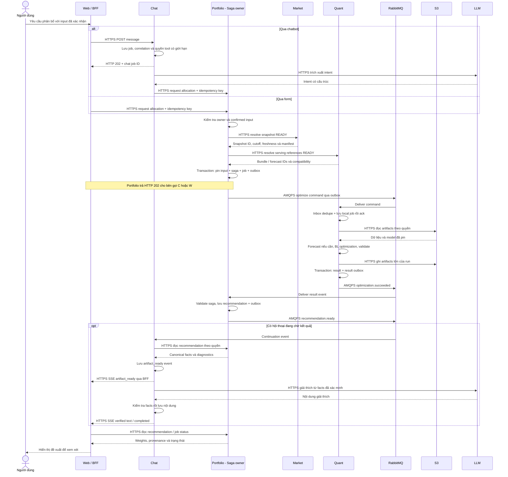
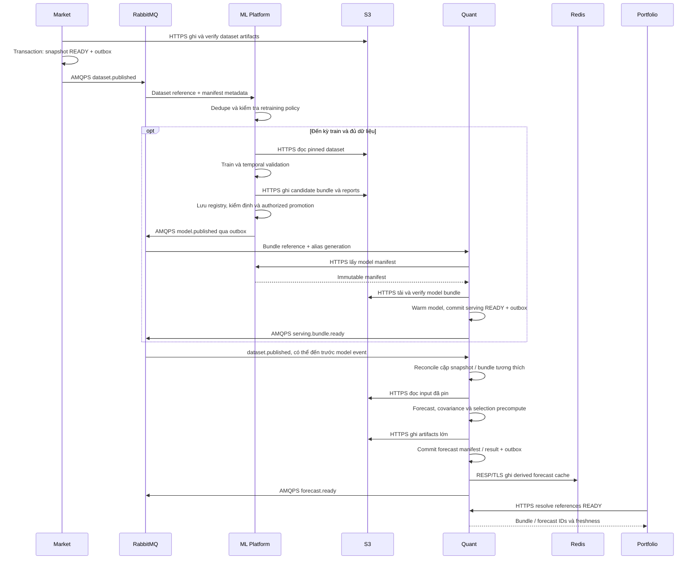
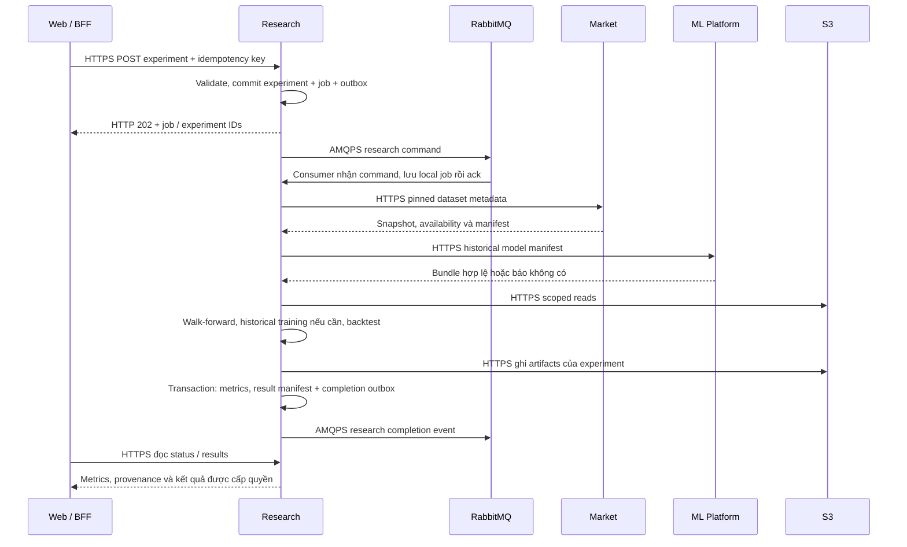

# Kiến trúc hệ thống, nhiệm vụ thành phần và các luồng tương tác

Đây là góc nhìn rút gọn của kiến trúc đề xuất cho giai đoạn 2: **microservices theo domain + event-driven orchestration**. Tài liệu mô tả trách nhiệm của 14 component, 37 kết nối và các luồng đầu–cuối; đây là thiết kế cần triển khai, không phải mô tả các service đã hoạt động.

Các luồng bên dưới diễn giải kiến trúc trong sơ đồ và thống nhất với [đặc tả kỹ thuật giai đoạn 2](TECHNICAL_SPECIFICATION_PHASE_2.md). Bản bố cục trong draw.io và [bản PlantUML](ARCHITECTURE_PLANTUML.md) là các cách trình bày cùng kiến trúc. Các sequence diagram làm rõ thứ tự tương tác; API handler, consumer và worker có thể thuộc cùng một service dù được triển khai bằng các process riêng.

**Cách đọc:** xem sơ đồ để nhận diện thành phần, phần nhiệm vụ để hiểu quyền sở hữu, rồi phần [Các luồng tương tác](#các-luồng-tương-tác) để theo dõi một yêu cầu đi qua hệ thống.

## Sơ đồ kiến trúc

```mermaid
flowchart TB
    classDef frontend fill:#D4EDDA,stroke:#28A745,stroke-width:2px,color:#155724;
    classDef business fill:#CCE5FF,stroke:#2563EB,stroke-width:2px,color:#173B70;
    classDef dataKnowledge fill:#CCFBF1,stroke:#0F766E,stroke-width:2px,color:#134E4A;
    classDef quantML fill:#EDE9FE,stroke:#7C3AED,stroke-width:2px,color:#4C1D95;
    classDef messaging fill:#FFEDD5,stroke:#EA580C,stroke-width:2px,color:#7C2D12;
    classDef storage fill:#FFF3CD,stroke:#A16207,stroke-width:2px,color:#713F12;
    classDef external fill:#F1F5F9,stroke:#64748B,stroke-width:2px,color:#334155;

    Web["Frontend: Next.js UI và server BFF"]
    Portfolio["Portfolio Service: profile, ledger, allocation saga"]
    Chat["Chat Service: intent, tools, explanations, SSE"]
    Market["Market Data Service: ingestion và snapshots"]
    Quant["Quant Serving: forecasts và BL optimization"]
    ML["ML Platform: training và registry"]
    Knowledge["Knowledge Service: RAG retrieval"]
    Research["Research Service: backtest và experiments"]
    MQ[("RabbitMQ: commands và domain events")]
    DB[("PostgreSQL databases; Knowledge có pgvector")]
    S3[("S3: artifacts theo owner, version")]
    Redis[("Redis: session, cache, stream hints")]
    Sources["Nguồn giá / NAV / tài liệu"]
    LLM["Hosted LLM / embedding provider"]

    Web -->|"HTTPS"| Portfolio
    Web -->|"HTTPS: REST và SSE"| Chat
    Web -->|"HTTPS: market reads"| Market
    Web -->|"HTTPS: backtest jobs"| Research
    Web -->|"RESP/TLS: session, chỉ server BFF"| Redis
    Chat -->|"HTTPS: scoped tools"| Portfolio
    Chat -->|"HTTPS: facts"| Market
    Chat -->|"HTTPS: retrieve citations"| Knowledge
    Chat -->|"HTTPS: structured intent / explanation"| LLM
    Knowledge -->|"HTTPS: document / query embeddings"| LLM
    Portfolio -->|"HTTPS: pin snapshot metadata"| Market
    Portfolio -->|"HTTPS: resolve ready model version"| Quant
    Portfolio <-->|"AMQPS: commands / result events qua outbox"| MQ
    Chat <-->|"AMQPS: continuation events"| MQ
    Market -->|"AMQPS: dataset.published"| MQ
    ML <-->|"AMQPS: training commands / model.published"| MQ
    Quant <-->|"AMQPS: optimize / forecast / ready events"| MQ
    Research <-->|"AMQPS: research commands / completion"| MQ
    Quant -->|"HTTPS: model manifest"| ML
    Research -->|"HTTPS: pinned dataset metadata"| Market
    Research -->|"HTTPS: historical model manifest"| ML
    Market -->|"HTTPS: source adapters"| Sources
    Knowledge -->|"HTTPS: allowlisted document ingestion"| Sources
    Portfolio -->|"SQL over TLS: portfolio_db only"| DB
    Chat -->|"SQL over TLS: chat_db only"| DB
    Market -->|"SQL over TLS: market_db only"| DB
    Quant -->|"SQL over TLS: quant_db only"| DB
    ML -->|"SQL over TLS: ml_db only"| DB
    Knowledge -->|"SQL over TLS: knowledge_db only"| DB
    Research -->|"SQL over TLS: research_db only"| DB
    Market -->|"HTTPS: dataset artifacts"| S3
    ML -->|"HTTPS: scoped dataset reads / model artifacts"| S3
    Quant -->|"HTTPS: scoped artifact reads / own run writes"| S3
    Research -->|"HTTPS: scoped reads / own experiment writes"| S3
    Knowledge -->|"HTTPS: source documents"| S3
    Chat -->|"RESP/TLS: SSE hints"| Redis
    Quant -->|"RESP/TLS: derived forecast cache"| Redis

    class Web frontend;
    class Portfolio,Chat business;
    class Market,Knowledge dataKnowledge;
    class Quant,ML,Research quantML;
    class MQ messaging;
    class DB,S3,Redis storage;
    class Sources,LLM external;
```

| Màu | Nhóm | Các node |
|---|---|---|
| Xanh lá | Giao diện và lớp phục vụ web | Frontend |
| Xanh dương | Nghiệp vụ và hội thoại | Portfolio, Chat |
| Xanh ngọc | Dữ liệu và tri thức | Market Data, Knowledge |
| Tím | Tính toán, mô hình và thực nghiệm | Quant Serving, ML Platform, Research |
| Cam | Truyền thông bất đồng bộ | RabbitMQ |
| Vàng | Lưu trữ và cache | PostgreSQL, S3, Redis |
| Xám | Nguồn và nhà cung cấp bên ngoài | Sources, LLM / embedding provider |

Màu biểu thị nhóm trách nhiệm; các service cùng màu vẫn triển khai độc lập. Tất cả các cạnh tới PostgreSQL dùng SQL qua TLS và chỉ truy cập database của service sở hữu. Mũi tên HTTPS biểu thị bên khởi tạo yêu cầu; dữ liệu trả về qua response dù không vẽ mũi tên ngược. Vì vậy, cạnh service → S3 có thể biểu diễn cả đọc và ghi theo quyền; cạnh Chat → Redis là thao tác của các instance Chat, gồm phát và nhận tín hiệu đánh thức SSE handler.

Nhãn ML → S3 được làm rõ để bao gồm đọc training dataset; nhãn Knowledge → LLM bao gồm cả embedding tài liệu và embedding truy vấn. Đây là chi tiết trên các kết nối sẵn có, không bổ sung service hoặc đường kết nối mới.

Node Frontend gộp UI trong trình duyệt và server BFF của Next.js. **Trong node Frontend, chỉ BFF kết nối Redis**; trình duyệt không có kết nối hay credentials Redis. Identity, ingress và monitoring được lược khỏi góc nhìn này, vẫn thuộc thiết kế production.

## Nguyên tắc tương tác

| Cơ chế | Dùng cho việc gì? | Ai giữ trạng thái chuẩn? |
|---|---|---|
| HTTPS / REST | Đọc facts, lưu hồ sơ, nhận yêu cầu, resolve phiên bản dữ liệu/mô hình, accept/reject | Service sở hữu resource; HTTP response trả kết quả hoặc mã job |
| AMQPS qua RabbitMQ | Chuyển command cho worker và thông báo domain event để workflow tiếp tục | Producer lưu outbox; consumer lưu inbox/job/kết quả trong DB riêng |
| SSE qua HTTPS | Đẩy tiến độ và nội dung đã kiểm tra từ service → BFF → trình duyệt | Bảng sự kiện bền vững của service sở hữu job; Redis chỉ là tín hiệu |
| SQL qua TLS | Ghi transaction nghiệp vụ, trạng thái job, audit, inbox/outbox | Database riêng của từng service |
| HTTPS tới S3 | Đọc/ghi dataset, model bundle, tài liệu và kết quả lớn | File được version hóa ở S3; manifest và trạng thái nằm trong DB của owner |
| RESP qua TLS tới Redis | Session phía BFF, cache forecast, stream hints | Redis giữ session đang hoạt động; cache/hints không thay thế dữ liệu nghiệp vụ bền vững |

**Portfolio điều phối allocation saga; Chat điều phối hội thoại; ML, Market, Knowledge và Research quản lý pipeline trong domain của mình.** Event-driven không có nghĩa tất cả service tự quyết định bước tiếp theo của cùng một nghiệp vụ. RabbitMQ chỉ định tuyến và chuyển thông điệp; Quant trả kết quả tính toán, còn Portfolio quyết định kết quả đó có trở thành đề xuất hợp lệ hay không.

API, consumer, worker và outbox dispatcher là các vai trò thực thi bên trong một service, không phải các domain mới. Không có transaction xuyên các database: mỗi bước commit cục bộ, sau đó dùng API/events để service khác tiếp tục. Request dài trả `202 Accepted` cùng ID để theo dõi; `202` chỉ xác nhận yêu cầu đã được tiếp nhận bền vững, chưa xác nhận phép tính đã thành công.

## Nhiệm vụ từng node

### 1. Frontend — giao diện người dùng và server BFF

Đây là nơi người dùng điền hồ sơ rủi ro, trò chuyện, xem danh mục, so sánh trọng số và xác nhận đề xuất. UI hiển thị biểu đồ cùng trạng thái job: đang chờ, đang tính, hoàn tất hoặc cần bổ sung thông tin.

BFF (*Backend for Frontend*) là phần chạy phía server của ứng dụng web: quản lý session, chuyển tiếp request đã xác thực tới các service và proxy luồng SSE về trình duyệt. Nó không tính trọng số danh mục. Ví dụ, khi người dùng bấm “Tạo đề xuất”, Frontend gửi yêu cầu và hiển thị tiến độ, sau đó tải kết quả chuẩn từ backend.

### 2. Portfolio Service — quản lý người dùng và danh mục

Sở hữu hồ sơ rủi ro, mục tiêu đầu tư, views đã xác nhận, danh mục, lịch sử giao dịch, đề xuất phân bổ và target đã được chấp nhận. **Ledger** là sổ ghi các sự kiện như nạp tiền, mua, bán và phí; từ đó hệ thống xác định lượng tài sản đang nắm giữ.

Service này kiểm tra quyền sở hữu và các ràng buộc cá nhân trước khi yêu cầu Quant tính toán. Nó cũng điều phối **allocation saga**: lưu yêu cầu → gửi lệnh tối ưu → nhận kết quả → lưu đề xuất → chờ người dùng chấp nhận. Saga là workflow nhiều bước qua các service, có trạng thái bền vững để tiếp tục khi một bước lỗi hoặc chạy chậm.

Ví dụ, cùng một bộ dự báo thị trường, người dùng có giới hạn cổ phiếu khác nhau sẽ nhận đề xuất khác nhau. Chấp nhận đề xuất chỉ cập nhật target; không đồng nghĩa hệ thống đã mua hoặc bán tài sản.

### 3. Chat Service — hiểu yêu cầu và điều phối hội thoại

Quản lý hội thoại, nhận diện ý định người dùng, thu thập thông tin còn thiếu và gọi các công cụ nghiệp vụ được cấp quyền. Ví dụ, câu “Giải thích vì sao danh mục của tôi có vàng” khiến Chat lấy kết quả danh mục hiện có để giải thích; không nhất thiết chạy tối ưu lại.

Chat lấy thông tin từ Portfolio, Market Data và Knowledge, rồi yêu cầu LLM diễn đạt bằng tiếng Việt. Các số liệu quan trọng được đối chiếu với kết quả backend trước khi hiển thị. **SSE** là luồng cập nhật một chiều từ server tới trình duyệt, dùng để báo tiến độ và gửi phần giải thích đã kiểm tra. Chat không được tự thay trọng số mà Quant đã tính.

### 4. Market Data Service — thu thập và chuẩn hóa dữ liệu thị trường

Thu thập giá cổ phiếu, giá vàng, NAV quỹ và metadata tài sản từ các nguồn bên ngoài. NAV ở đây là giá trị tài sản ròng trên một đơn vị/chứng chỉ quỹ dùng trong dữ liệu quỹ. Service chuẩn hóa đơn vị giá, lịch giao dịch, thời điểm công bố; kiểm tra dữ liệu thiếu, cũ hoặc bất thường.

Khi dữ liệu đạt yêu cầu, Market tạo **snapshot**: một phiên bản dữ liệu cố định để các lần tính có thể tham chiếu và tái lập. Metadata được lưu trong PostgreSQL, dữ liệu/file lớn ở S3; sự kiện `dataset.published` thông báo cho các service liên quan. Nếu nguồn sửa giá cũ, hệ thống tạo revision mới thay vì âm thầm thay input của kết quả đã lưu.

### 5. Quant Serving — dự báo và tối ưu danh mục

Chạy inference bằng mô hình đã được duyệt, chuẩn bị forecasts, covariance, tập tài sản đại diện và thực hiện Black–Litterman/optimizer. Đây là nơi tích hợp phần tính toán từ `gen_view`, XGBoost và lõi tối ưu của giai đoạn 1.

Quant nhận input đã được Portfolio xác nhận, tính trọng số theo ràng buộc của danh mục rồi kiểm tra tính khả thi. Output gồm weights, views đã dùng, phiên bản dữ liệu/mô hình và diagnostics của solver. Forecast có thể dùng chung giữa nhiều người; final weights chỉ dùng chung khi toàn bộ input cá nhân hóa thực sự khớp. Quant không huấn luyện lại mô hình trong mỗi lượt chat.

### 6. ML Platform — huấn luyện và quản lý vòng đời mô hình

Thực hiện training theo lịch hoặc yêu cầu được cấp quyền; đánh giá candidate models và quản lý model registry. **Registry** ghi mô hình nào đang thử nghiệm, đã đạt kiểm định, được duyệt để phục vụ hoặc đã ngừng sử dụng.

Model files nằm ở S3; metadata và lịch sử promotion nằm trong database của ML Platform. **Model manifest** là bản kê mô hình: vị trí file, checksum, feature schema, phạm vi dữ liệu train và phiên bản liên quan. Quant dùng manifest để tải đúng bundle. Nếu candidate mới không đạt, mô hình đang phục vụ vẫn được giữ; rollback chọn lại phiên bản đã duyệt.

### 7. Knowledge Service — cung cấp tri thức và nguồn dẫn cho RAG

Tiếp nhận tài liệu từ các nguồn được cho phép, chia nội dung thành các đoạn, tạo embeddings và lập chỉ mục tìm kiếm. Embedding là biểu diễn số của nội dung, giúp tìm các đoạn gần nhau về ý nghĩa.

Khi Chat cần trả lời câu hỏi kiến thức, Knowledge trả về các đoạn liên quan cùng nguồn, phiên bản tài liệu và vị trí trích dẫn. Đây là phần retrieval trong **RAG**: tìm bằng chứng trước khi LLM viết câu trả lời. Ví dụ, câu hỏi “Black–Litterman kết hợp quan điểm như thế nào?” dùng Knowledge; câu hỏi “Giá tài sản tại ngày này là bao nhiêu?” lấy dữ liệu có cấu trúc từ Market.

### 8. Research Service — backtest và quản lý thực nghiệm

Chạy backtest trên dữ liệu lịch sử, so sánh EW/MVO/BL/HYBRID, thực hiện ablation và lưu kết quả phục vụ luận văn. Mỗi experiment cố định data snapshot, cấu hình, phiên bản lõi, lịch train và giả định chi phí/thời điểm giao dịch.

Research sử dụng cùng thư viện lõi định lượng đã version hóa với Quant, nhưng chạy worker và quota riêng để công việc nặng không chiếm tài nguyên phục vụ người dùng. Historical backtest phải dùng mô hình hợp lệ tại từng thời điểm hoặc train lại theo protocol walk-forward; không dùng mô hình biết dữ liệu tương lai để dự báo quá khứ. Kết quả nghiên cứu không tự được đưa thành model production.

### 9. RabbitMQ — chuyển lệnh và sự kiện giữa các service

Là message broker cho những công việc không cần hoàn tất trong một HTTP request. **Command** yêu cầu thực hiện công việc, ví dụ “tối ưu danh mục này”; **event** thông báo một việc đã xảy ra, ví dụ “dataset đã được công bố” hoặc “tối ưu đã hoàn tất”. AMQPS là giao thức AMQP được bảo vệ bằng TLS.

Queue giữ công việc chờ consumer xử lý và hỗ trợ giao lại khi cần. Các service phải xử lý được thông điệp trùng, không giả định mỗi message chỉ tới đúng một lần. **Outbox** là bản ghi thông điệp trong database của service, được ghi cùng transaction nghiệp vụ rồi mới gửi lên broker, giúp tránh tình huống lưu job thành công nhưng mất lệnh gửi. RabbitMQ không sở hữu dữ liệu danh mục hay quyết định nghiệp vụ.

### 10. PostgreSQL databases — lưu dữ liệu có cấu trúc

Lưu các bản ghi cần transaction và ràng buộc dữ liệu: hồ sơ, ledger, recommendation, hội thoại, giá, model metadata, jobs và audit. Node này gộp nhiều database logic cho hình dễ nhìn, **không biểu thị một database dùng chung mà mọi service tùy ý đọc/ghi**.

Portfolio sở hữu `portfolio_db`, Chat sở hữu `chat_db`, các service khác có database tương ứng và credentials riêng. Trao đổi dữ liệu giữa service thông qua API/events. Database của Knowledge có thêm `pgvector` để lưu và tìm kiếm embeddings cùng metadata tài liệu.

### 11. S3 — lưu file dữ liệu, mô hình và kết quả lớn

Lưu các **artifacts** như raw data, Parquet snapshots, model files, tài liệu gốc, ma trận và chuỗi kết quả backtest. Artifact là một sản phẩm dữ liệu/file được tạo ra hoặc sử dụng trong pipeline.

Mỗi artifact có owner, version, checksum và quyền truy cập. Database lưu bản kê/tham chiếu; S3 lưu nội dung file. Ví dụ, ML Platform ghi model bundle lên S3, Quant được cấp quyền đọc đúng bundle đó, rồi ghi kết quả run vào vùng do Quant sở hữu. Versioning và checksum giúp truy nguyên; chính sách quyền ghi/xóa giữ các artifacts đang được tham chiếu không bị thay đổi tùy ý.

### 12. Redis — session, cache và tín hiệu cập nhật nhanh

Phục vụ ba mục đích trong hình: BFF tra session; Quant cache forecasts đã tính; Chat phát tín hiệu để handler SSE biết có cập nhật mới. **Stream hint** chỉ là tín hiệu đánh thức handler, không phải lịch sử hội thoại hay bản ghi kết quả chuẩn.

Cache có thể dựng lại từ dữ liệu của service sở hữu. SSE events cần lưu bền vững để client reconnect và đọc lại; không chỉ dựa vào Redis Pub/Sub. Session store cần tách khỏi cache có cơ chế eviction; nếu mất session, hệ thống yêu cầu xác thực lại thay vì bỏ qua kiểm tra đăng nhập.

### 13. Nguồn giá / NAV / tài liệu — nguồn dữ liệu bên ngoài

Đại diện cho các nhà cung cấp giá/NAV và nguồn tài liệu được hệ thống sử dụng. Trong dự án hiện tại có adapters liên quan tới vnstock và dữ liệu vàng PNJ; nguồn tài liệu có thể là tài liệu phương pháp, tài chính hoặc báo cáo đã được duyệt.

Market Data đọc phần dữ liệu thị trường; Knowledge đọc tài liệu. Sources không truy cập trực tiếp database nội bộ. Mỗi nguồn cần được kiểm soát về schema, lịch công bố, chất lượng và quyền sử dụng trước khi đưa dữ liệu vào sản phẩm.

### 14. Hosted LLM / embedding provider — nhà cung cấp mô hình ngôn ngữ

Cung cấp API cho hai tác vụ: LLM giúp Chat trích xuất ý định và diễn giải thông tin; embedding model giúp Knowledge biểu diễn tài liệu để tìm kiếm. Node này biểu diễn một nhóm dịch vụ bên ngoài, có thể dùng một hoặc nhiều provider thực tế.

Provider không tính trọng số danh mục chuẩn thay Quant và không được truy cập trực tiếp database nội bộ. Chat/Knowledge gửi lượng dữ liệu cần thiết qua API có kiểm soát. Khi LLM lỗi, kết quả định lượng vẫn được giữ và hệ thống có thể dùng template giải thích từ các facts đã xác thực.

## Các luồng tương tác

### Flow 1 — Mở ứng dụng, xác thực và chuẩn bị hồ sơ đầu tư

**Kích hoạt:** người dùng đăng nhập, tạo danh mục hoặc cập nhật mục tiêu/rủi ro.

1. Trình duyệt gửi request HTTPS tới Next.js BFF. BFF kiểm tra session trong Redis; bước xác thực với Identity Provider thuộc hạ tầng đã lược khỏi hình.
2. BFF gọi Portfolio qua HTTPS với danh tính người dùng và quyền phù hợp. Portfolio tự kiểm tra quyền sở hữu resource, không chỉ tin vào việc request đã đi qua BFF.
3. Portfolio lưu bản nháp hồ sơ, mục tiêu, hạn chế đầu tư hoặc views trong `portfolio_db`. Chat có thể hỗ trợ điền bản nháp nhưng nội dung do LLM suy ra chưa được coi là input đã xác nhận.
4. Người dùng xem lại và xác nhận trên UI. Portfolio tạo phiên bản hồ sơ/views cố định; những phiên bản này sẽ được tham chiếu khi tạo yêu cầu phân bổ.
5. Khi mở màn hình danh mục, BFF đọc holdings, target và recommendation từ Portfolio; khi mở màn hình tài sản, BFF đọc giá/NAV và metadata từ Market.

**Kết quả:** có hồ sơ và danh mục thuộc đúng người dùng, kèm version rõ ràng. Thao tác này chưa chạy tối ưu và chưa phát sinh mua/bán.

### Flow 2 — Chat trả lời câu hỏi bằng dữ liệu và tri thức

**Kích hoạt:** người dùng hỏi kiến thức, hỏi facts thị trường hoặc yêu cầu giải thích một danh mục đã có.

1. UI gửi message qua BFF tới Chat bằng HTTPS POST. Chat lưu message/job trong `chat_db`, trả ID theo dõi; BFF proxy SSE về trình duyệt.
2. Chat gọi LLM để trích xuất ý định theo schema. Chat kiểm tra tên tool, tham số và phạm vi quyền trước khi gọi service; output của LLM không tự tạo quyền truy cập.
3. Tùy câu hỏi, Chat gọi một hoặc nhiều API: Portfolio cho hồ sơ/kết quả danh mục; Market cho giá/NAV/facts; Knowledge cho đoạn tài liệu và citations.
4. Nếu cần vector retrieval, Knowledge tạo embedding của câu hỏi qua provider, tìm trong `knowledge_db`/pgvector và lọc theo quyền truy cập, phiên bản, thời điểm tài liệu có thể được sử dụng. Embedding truy vấn phải tương thích với phiên bản index tài liệu.
5. Chat gửi các facts và passages cần thiết tới LLM để soạn câu trả lời. Nội dung tài liệu là bằng chứng tham khảo, không phải chỉ thị có quyền gọi tool.
6. Chat kiểm tra số liệu/nguồn, lưu phần trả lời đã xác minh rồi phát qua SSE. Những nội dung không kiểm chứng được dùng template hoặc thông báo thiếu bằng chứng.

**Kết quả:** câu trả lời có nguồn và số liệu lấy từ service sở hữu. Câu “Vì sao danh mục này có vàng?” đọc recommendation hiện có; không tự tạo optimization job mới. Nếu ý định là tạo một phân bổ mới, Chat chuyển sang Flow 3.

### Flow 3 — Tạo đề xuất phân bổ: allocation saga

**Kích hoạt:** người dùng gửi yêu cầu qua chatbot hoặc bấm “Tạo đề xuất” trên form. Cả hai đường vào đều gọi Portfolio để bắt đầu cùng một workflow.

**Bước 1 — Kiểm tra và cố định input.** Portfolio kiểm tra owner, hồ sơ/views đã xác nhận và constraints. Nó gọi Market để chọn snapshot đã `READY`, đủ mới và hợp lệ; gọi Quant để resolve model bundle/forecast tương thích và sẵn sàng. Portfolio lưu các version hồ sơ, policy, holdings nếu được dùng, views, snapshot, model và cấu hình chiến lược cùng `input_hash`. “Pin” nghĩa là cố định các tham chiếu này cho run, không để model hoặc dữ liệu đổi giữa chừng.

**Bước 2 — Tiếp nhận bền vững.** Portfolio ghi allocation request, trạng thái saga, job và optimize command trong outbox bằng một transaction `portfolio_db`, rồi trả `202`. Dispatcher chuyển command qua RabbitMQ tới Quant. Khi đi qua Chat, Chat lưu correlation/dependency và idempotency key trước lời gọi để có thể tìm lại đúng yêu cầu nếu request bị gián đoạn.

**Bước 3 — Tính toán.** Quant consumer chống trùng bằng inbox, lưu local job rồi xác nhận đã nhận message. Quant worker đọc artifacts được cấp quyền ở S3, dùng forecast đúng phiên bản hoặc tạo forecast còn thiếu theo job đã quản lý; chạy lõi Black–Litterman/optimizer và kiểm tra constraints. Kết quả run thuộc `quant_db`; artifacts lớn thuộc vùng S3 của Quant.

**Bước 4 — Chuyển kết quả thành đề xuất.** Quant commit kết quả và result event vào outbox. Portfolio nhận event, đối chiếu request, input hash, versions và tính hợp lệ rồi mới lưu recommendation cùng event `recommendation.ready`. Event kết quả cần mang phần dữ liệu có cấu trúc đủ để Portfolio kiểm tra/lưu đề xuất, gồm weights và diagnostics cần thiết; file lớn chỉ được tham chiếu. Flow này không yêu cầu Portfolio truy cập trực tiếp `quant_db` hoặc S3.

**Bước 5 — Hiển thị và giải thích.** Chat nhận continuation event, gọi Portfolio để đọc recommendation chuẩn và phát `artifact_ready`. UI tải recommendation qua BFF → Portfolio để vẽ allocation card. Chat tạo phần giải thích bằng LLM sau đó; lỗi giải thích không làm mất recommendation hợp lệ.

Sequence thể hiện nhánh thành công khi input và dependencies sẵn sàng. Nếu thiếu hồ sơ/views đã xác nhận, yêu cầu dừng ở `WAITING_INPUT`. Nếu cần chờ một forecast job, Portfolio lưu dependency và deadline (`WAITING_DEPENDENCY`), tiếp tục khi có event hoặc reconciliation; HTTP handler không đứng chờ inference/training. Thiếu model tương thích chỉ được dùng fallback nếu policy đã cho phép và phải hiển thị `DEGRADED`.

**Ranh giới trách nhiệm:** Quant hoàn tất phép tính không đồng nghĩa người dùng đã chấp nhận danh mục. Chat chỉ được yêu cầu/tìm đọc đề xuất bằng tool có scope; accept target, ghi giao dịch và promote model là thao tác xác nhận riêng, không phải autonomous LLM tools.

### Flow 4 — Chấp nhận đề xuất, ledger và tái cân bằng

**Kích hoạt:** người dùng xem kết quả rồi chọn chấp nhận hoặc từ chối.

1. UI gửi quyết định qua BFF → Portfolio, kèm `Idempotency-Key` và `If-Match` của portfolio version gắn với đề xuất.
2. Trong transaction, Portfolio kiểm tra quyền sở hữu, trạng thái/expiry của recommendation, portfolio version, hồ sơ/policy/views liên quan và freshness. Nếu input đã đổi hoặc đề xuất hết hạn, người dùng cần tạo/kiểm tra lại đề xuất; không âm thầm chấp nhận kết quả cũ.
3. Nếu hợp lệ, Portfolio tạo **allocation target version** và audit. Chấp nhận chỉ đổi mục tiêu phân bổ, không đổi lượng tài sản đang nắm giữ.
4. Một yêu cầu PAPER execution riêng hoặc việc người dùng ghi nhận giao dịch MANUAL mới tạo ledger entries. Worker PAPER vẫn thuộc domain Portfolio; kiến trúc này chưa có kết nối tới broker giao dịch thật.
5. Portfolio dựng holdings từ ledger và gọi Market lấy dữ liệu định giá tại snapshot phù hợp. Holdings và giá xác định current weights; target là bộ trọng số mục tiêu độc lập.
6. Khi người dùng yêu cầu hoặc scheduler của Portfolio phát hiện đến lịch/drift vượt ngưỡng, Portfolio khởi tạo saga tái cân bằng: pin holdings/target/input → Quant tính đề xuất → Portfolio kiểm tra chi phí, làm tròn và constraints → UI cho người dùng duyệt lại.

**Kết quả:** tách rõ `recommendation → accepted target → execution/recorded transactions → holdings`. Sửa một giao dịch dùng reversal và bản ghi thay thế, không xóa lịch sử ledger. Scheduler không tự giao dịch chỉ vì giá hoặc target đã thay đổi.

### Flow 5 — Thu thập dữ liệu thị trường và công bố snapshot

**Kích hoạt:** lịch ingestion hoặc yêu cầu vận hành được cấp quyền trong domain Market.

1. Market dùng source adapters gọi nguồn giá/NAV qua HTTPS, chuẩn hóa đơn vị, lịch giao dịch, timestamp và thời điểm dữ liệu được công bố.
2. Market kiểm tra chất lượng. Dữ liệu thiếu/cũ hoặc sai bất thường được đánh dấu/quarantine; không công bố như snapshot hợp lệ cho tối ưu.
3. Market ghi dataset artifacts lên S3, xác thực checksum, rồi commit manifest, trạng thái snapshot `READY` và outbox event trong `market_db`. S3 upload và SQL commit là hai bước riêng, không phải một distributed transaction.
4. Dispatcher phát `dataset.published` qua RabbitMQ. Event mang immutable snapshot reference, cutoff, schema/version, quality metadata và manifest cần thiết; không gửi toàn bộ bảng giá qua broker.
5. Quant nhận event để chuẩn bị forecast; ML nhận event để đánh giá điều kiện retrain. Nhận một dataset mới không có nghĩa ML bắt buộc train ngay.
6. BFF/Chat gọi Market để đọc facts; Portfolio gọi Market để pin snapshot cho phân bổ; Research gọi Market để lấy pinned dataset metadata cho backtest. Các service cần file lớn đọc S3 bằng quyền được giới hạn theo manifest.

**Kết quả:** một phiên bản dataset có thể truy nguyên. Khi nguồn sửa dữ liệu cũ, Market tạo revision mới; run đã hoàn thành vẫn giữ tham chiếu snapshot cũ.

### Flow 6 — Huấn luyện, publish model và chuẩn bị serving

**Kích hoạt:** scheduler/quyền quản trị của ML tạo training command, hoặc `dataset.published` làm thỏa điều kiện của retraining policy. Các scheduler/worker này thuộc ML Platform; không bổ sung một service điều phối chung.

1. ML ghi training job và command vào local outbox, chuyển qua RabbitMQ tới consumer/worker của ML. Input cố định dataset, cutoff, feature schema, cấu hình và code version.
2. ML đọc dataset artifacts được cấp quyền từ S3, train và đánh giá theo temporal protocol. Model bundle, scaler parameters, metrics và validation report được ghi vào S3; registry metadata nằm trong `ml_db`.
3. Candidate đi qua kiểm định và quy trình promotion có quyền. Chỉ khi được duyệt, ML cập nhật production alias/generation bằng transaction và phát `model.published` qua outbox. Candidate thất bại không thay model đang phục vụ.
4. Quant nhận event, gọi ML qua HTTPS lấy manifest của đúng bundle/version, tải model từ S3, kiểm tra checksum/schema/coverage và warm model. Quant mới đánh dấu bundle `READY` và phát `serving.bundle.ready` sau khi các bước này thành công.
5. Quant kết hợp dataset đã công bố và bundle tương thích để chạy forecast/precompute. Kết quả bền vững ở `quant_db`/S3; Redis giữ bản cache có key gồm snapshot, bundle và cấu hình ảnh hưởng phép tính.
6. Quant phát `forecast.ready`; Portfolio có thể resolve các references này khi tạo allocation request. Forecast không chứa constraints cá nhân hóa có thể tái sử dụng; weights cuối cùng vẫn được tính theo input của từng danh mục.

**Điểm cần giữ rõ:** `PRODUCTION` ở ML registry và `READY` ở Quant là hai trạng thái khác nhau. Event dữ liệu/model có thể đến bất kỳ thứ tự; Quant reconcile và dedupe theo bộ input, không giả định thứ tự toàn cục. Rollback tạo alias generation mới trỏ về bundle đã duyệt; các run đang chạy vẫn dùng bundle ID đã pin, không đổi model giữa run. Training không nằm trên đường xử lý bắt buộc của mỗi lượt chat.

### Flow 7 — Nạp tài liệu và xây dựng kho tri thức

**Kích hoạt:** pipeline Knowledge nhận nguồn tài liệu đã được cho phép.

1. Knowledge tải tài liệu qua HTTPS từ Sources, kiểm tra loại file, giới hạn kích thước, quyền truy cập và nguồn allowlist.
2. Tài liệu gốc được lưu theo version/hash trong vùng S3 do Knowledge sở hữu. Metadata ghi nguồn, thời điểm công bố/khả dụng và access scope.
3. Knowledge tách tài liệu thành chunks kèm vị trí trang/mục và gọi embedding provider qua HTTPS theo batch.
4. Knowledge ghi chunk text, vectors và embedding/index version vào `knowledge_db` có pgvector. Phiên bản index chỉ được phục vụ sau khi ingest hoàn tất; đổi embedding model/dimension cần index tương thích mới.
5. Khi Chat gọi retrieval API, Knowledge trả passages và citations có document version/locator. Việc tạo query embedding diễn ra ở Knowledge như Flow 2, không buộc Chat tự truy cập pgvector.

**Kết quả:** kho tri thức có nguồn dẫn và ranh giới quyền. Theo sơ đồ hiện tại, Knowledge quản lý pipeline nội bộ; không có cạnh Knowledge ↔ RabbitMQ nên flow này không mặc định thêm pub/sub liên service. Luồng RAG và pipeline giá/NAV của Market độc lập về quyền sở hữu dù cùng đọc node Sources.

### Flow 8 — Chạy backtest và thực nghiệm cho luận văn

**Kích hoạt:** người dùng có quyền research gửi cấu hình qua màn hình backtest: chiến lược, universe, khoảng thời gian, lịch rebalance, chi phí và protocol.

1. BFF gọi Research qua HTTPS. Research kiểm tra quyền/quota, lưu experiment, job, cấu hình và research command trong outbox rồi trả `202` cùng ID theo dõi.
2. RabbitMQ chuyển command tới Research consumer; consumer lưu nhận việc trước khi ack, worker chạy backtest trên tài nguyên/quota riêng.
3. Research gọi Market để resolve pinned dataset metadata, gọi ML để lấy historical model manifest phù hợp, rồi đọc artifacts được cấp quyền từ S3.
4. Ở mỗi decision cutoff, Research chỉ dùng dữ liệu/model đã khả dụng tại thời điểm đó. Nếu protocol yêu cầu historical retraining, Research chạy versioned trainer/core trên dữ liệu đã cắt thời gian và lưu bundle trong vùng research-owned; không lấy current production model để dự báo quá khứ.
5. Research gọi thư viện lõi định lượng cùng version với Quant để chạy EW/MVO/BL/HYBRID và các biến thể được cấu hình. Đây là tái sử dụng **package/lõi**, không phải một cạnh HTTP Research → Quant mới trong sơ đồ.
6. Research lưu metrics/manifest/status trong `research_db`, equity curves, allocations và reports lớn ở S3; commit completion event vào outbox rồi phát qua RabbitMQ.
7. UI đọc status và kết quả từ Research qua BFF, hiển thị so sánh chiến lược và cho tải artifacts qua cơ chế cấp quyền của owner. UI không subscribe trực tiếp RabbitMQ; flow nghiên cứu độc lập với hội thoại Chat.

**Kết quả:** bộ bằng chứng tái lập cho luận văn. Kết quả tốt trong một experiment không tự promote model lên production; việc đó vẫn phải qua ML validation/promotion.

### Flow 9 — Cập nhật tiến độ, SSE và khôi phục sau mất kết nối

**Kích hoạt:** một job đang chạy, có kết quả hoặc trình duyệt kết nối lại.

1. Job thuộc service nào thì service đó lưu trạng thái và bảng sự kiện của job. Với hội thoại, Chat nhận continuation events từ broker, cập nhật projection/dependency và ghi `job_event` có sequence trong `chat_db`.
2. Sau khi commit sự kiện/nội dung, Chat gửi hint qua Redis để các Chat SSE handler đang giữ kết nối biết cần đọc dữ liệu mới. Redis hint không chứa toàn bộ lịch sử chuẩn và có thể bị mất mà không làm mất kết quả.
3. Handler đọc các sự kiện đã lưu, gửi SSE qua BFF tới trình duyệt. UI nhận `stage_changed` để cập nhật tiến độ và `artifact_ready` để biết lúc nào cần tải resource chuẩn qua API.
4. Khi mất kết nối, job tiếp tục chạy. Client reconnect với `Last-Event-ID`; service kiểm tra quyền và replay các sequence còn thiếu từ database. Hết retention thì yêu cầu client reset và tải lại trạng thái/nội dung hoàn chỉnh.
5. Nếu Redis hints lỗi, handler có thể kiểm tra bảng sự kiện định kỳ. Nếu session Redis lỗi, BFF không bỏ qua xác thực; yêu cầu cần session phải chờ khôi phục hoặc đăng nhập lại theo chính sách.

**Kết quả:** có thể mở nhiều instance Chat/BFF, reload trang và tiếp tục theo dõi job. Đường nhận sự kiện của UI luôn qua HTTPS; không có browser → Redis hoặc browser → RabbitMQ. Các job tạo trực tiếp qua Portfolio/Research có thể theo dõi bằng status API hoặc stream do chính owner cung cấp, không cần tạo một cuộc chat giả.

## Thông điệp và cách các service tiếp tục workflow

Các tên dưới đây là tên nghiệp vụ minh họa, thống nhất với cách gọi trong đặc tả; schema version và routing key cụ thể phải được cố định trong contract khi triển khai. **Consumer là service nhận qua RabbitMQ**, không phải kết nối trực tiếp giữa hai service.

| Command / event | Producer | Consumer chính | Ý nghĩa và hành động tiếp theo |
|---|---|---|---|
| `optimize.requested` | Portfolio | Quant | Tính phân bổ từ validated input và immutable references |
| `optimization.succeeded` | Quant | Portfolio | Đã có kết quả tính; Portfolio đối chiếu saga và tạo recommendation nếu hợp lệ |
| `optimization.failed` | Quant | Portfolio | Lưu nguyên nhân; chuyển trạng thái hoặc retry theo loại lỗi/policy |
| `recommendation.ready` | Portfolio | Chat có dependency tương ứng | Đề xuất đã lưu ở owner; Chat đọc API để giải thích và báo UI |
| Allocation terminal event: failed/cancelled | Portfolio | Chat có dependency tương ứng | Kết thúc hoặc cập nhật trạng thái chờ; không để hội thoại treo |
| `dataset.published` | Market | Quant, ML | Có dataset version mới; precompute hoặc đánh giá điều kiện retrain |
| Training command | ML scheduler/API | ML consumer/worker | Nhận một training job đã được ghi nhận và cấp quyền |
| `model.published` | ML | Quant | Registry đã publish/promote; Quant còn phải tải, verify và warm |
| `serving.bundle.ready` | Quant | Portfolio theo dependency | Bundle có thể phục vụ; vẫn resolve đúng version và freshness |
| `forecast.ready` | Quant | Portfolio theo dependency | Forecast cho một bộ input đã sẵn sàng; resume job đang chờ nếu khớp |
| Research command / completion | Research API / worker | Research consumer / consumer được cấp quyền theo nhu cầu | Chạy experiment và thông báo kết thúc; UI đọc kết quả từ Research |

Chat chỉ consume sự kiện có liên quan tới dependency đã lưu của mình; không tự giải thích tất cả recommendation trong hệ thống. Consumer nào cần bản sao một event có queue riêng; các replica cùng thực hiện một vai trò consumer chia sẻ queue để phân phối tải. Command nhắm tới một vai trò xử lý, còn event có thể được nhiều domain subscribe độc lập.

Envelope thông điệp gồm `event_id` (ID thông điệp), `type`, `schema_version`, `producer`, `occurred_at`, `correlation_id`, `causation_id`, aggregate ID/version, trace context và payload tối thiểu. `correlation_id` nối các bước của cùng workflow; `causation_id` chỉ thông điệp/yêu cầu dẫn tới bước hiện tại. Không đưa bearer token, credentials hay toàn bộ hội thoại vào message bus.

## Lưu trạng thái, retry và các nhánh lỗi

### Quy tắc nhất quán

1. **Commit local trước khi publish:** nghiệp vụ/job và outbox được ghi cùng transaction. Dispatcher chỉ đánh dấu đã publish sau broker confirm; nếu bị gián đoạn, có thể gửi lại cùng message ID.
2. **Nhận việc bền vững trước khi ack:** consumer commit inbox và local job/domain mutation trước acknowledgement. Worker nặng chạy sau; tiến độ/kết quả có lease, attempt và fencing token để worker cũ không ghi đè attempt mới.
3. **Chấp nhận khả năng gửi trùng:** delivery là at-least-once. Dedupe message theo consumer/event ID và bảo vệ side effect theo logical request/stage; không tuyên bố toàn hệ thống exactly-once.
4. **Idempotency cho API:** retry dùng cùng key và body để lấy lại request cũ; cùng key nhưng body khác bị từ chối. Accept/ledger cần bảo vệ nghiệp vụ bền vững, không chỉ cache HTTP response ngắn hạn.
5. **Không phụ thuộc thứ tự event toàn cục:** kiểm tra aggregate version, dependency và input hash. Nếu thiếu event hoặc thấy version gap, reconcile với owner qua API phù hợp; waiting jobs luôn có deadline.
6. **Artifact publish có hai bước:** upload + verify S3 trước, sau đó commit manifest `READY` cùng outbox. File mồ côi do transaction thất bại được dọn theo lifecycle; manifest chưa `READY` không được dùng như input hợp lệ.

### Hành vi khi có lỗi

| Tình huống | Service xử lý và trạng thái người dùng thấy |
|---|---|
| Thiếu hồ sơ hoặc view chưa xác nhận | Chat/Portfolio yêu cầu bổ sung; chưa gửi lệnh tối ưu |
| Snapshot cũ, thiếu dữ liệu hoặc quarantine | Market báo quality/freshness; Portfolio chặn đề xuất mới có thể accept |
| Bundle được publish nhưng Quant chưa ready | Giữ job chờ có deadline hoặc dùng version trước đã duyệt nếu policy cho phép |
| Solver infeasible | Quant trả diagnostics; Portfolio báo cần sửa constraints, không tự nới giới hạn |
| Profile/holdings đổi trong khi đang tính | Portfolio giữ evidence, đánh dấu kết quả không còn hiện hành, ví dụ `SUPERSEDED`; không cho accept |
| LLM lỗi hoặc câu trả lời không đủ bằng chứng | Chat dùng template/facts đã xác minh; recommendation hợp lệ vẫn được giữ |
| RabbitMQ tạm gián đoạn | Outbox giữ lệnh chưa gửi; UI hiển thị queued/delayed và deadline, không báo đang tính khi chưa nhận việc |
| Worker crash hoặc message trùng | Owner phục hồi qua lease/inbox/idempotency; không tạo kết quả hoặc side effect trùng |
| Retry vượt giới hạn hoặc lỗi không thể phục hồi | Job thất bại có error code. Message không xử lý được chuyển DLQ theo delivery policy và chỉ replay có audit; job tính toán thất bại sau khi command đã được ack phải phát failure event, không trông chờ DLQ tự phục hồi |
| Event đến trước HTTP response | Chat đối chiếu correlation đã lưu; retry cùng idempotency key để khôi phục dependency |
| Người dùng hủy job | Owner lưu cancel request; worker dừng ở checkpoint. Kết quả đến muộn được đối chiếu trạng thái, không tự accept |
| S3 lỗi hoặc checksum không khớp | Không đưa artifact chưa xác thực vào tính toán; trả lỗi/chờ theo policy |

Việc hủy allocation saga không tạo lệnh bán để “hoàn tác”, vì saga tạo đề xuất chưa thực hiện giao dịch. Mất kết nối trình duyệt cũng không tương đương yêu cầu hủy. Audit và operational logs lưu correlation/job/run ID để theo dấu toàn bộ đường đi; logs không thay thế trạng thái nghiệp vụ trong database.

## Kết quả chuẩn nằm ở đâu?

| Câu hỏi cần trả lời | Nguồn chuẩn và đường đọc |
|---|---|
| Người dùng đã xác nhận hồ sơ/views nào? | Portfolio → `portfolio_db`; BFF/Chat đọc Portfolio API |
| Đề xuất nào được chấp nhận, hiện đang giữ gì? | Portfolio → target versions và ledger/holdings; không suy từ lời giải thích chat |
| Giá/NAV hoặc dataset version nào đã dùng? | Market → `market_db` manifest và S3 snapshot; đọc Market API / artifact theo scope |
| Model nào được duyệt và model nào sẵn phục vụ? | ML registry xác định promotion; Quant xác định serving readiness; phân biệt hai trạng thái |
| Forecast/weights được tính thế nào? | Quant → run metadata, input hash, diagnostics và artifacts; Portfolio giữ recommendation được kiểm tra từ kết quả đó |
| Chat đã trả lời gì và dựa vào nguồn nào? | Chat → messages, tool audit, citations/fact references và durable stream events |
| Đoạn tài liệu đến từ đâu? | Knowledge → document/chunk/index versions trong `knowledge_db`, tài liệu gốc ở S3 |
| Backtest có thể tái lập không? | Research → experiment manifest, config, cutoff/model schedule, core version và S3 artifacts |

Để chuyển sang triển khai, dùng tài liệu này cho việc hiểu tương tác; dùng các mục API, workflow, model serving, ERD và bảo mật trong [đặc tả kỹ thuật](TECHNICAL_SPECIFICATION_PHASE_2.md) để chốt request/response schemas, event contracts và acceptance criteria.
