# Đặc tả kỹ thuật ứng dụng tư vấn phân bổ danh mục đầu tư

**Phiên bản:** 1.0 — thiết kế giai đoạn 2  
**Ngày:** 25/09/2026  
**Định hướng đã xác nhận:** sản phẩm hướng production, nhiều người dùng, các dịch vụ triển khai độc lập.  
**Trạng thái:** đặc tả để xây dựng; không phải tuyên bố các thành phần đã được triển khai.

## 1. Mục tiêu, phạm vi và cơ sở thiết kế

Xây dựng ứng dụng web tiếng Việt hỗ trợ hồ sơ rủi ro, phân bổ tài sản, giải thích qua chatbot, theo dõi danh mục và tái cân bằng. Tái sử dụng Black–Litterman (BL), XGBoost, sinh views và backtest từ giai đoạn 1; đồng thời lưu bằng chứng thực nghiệm cho luận văn.

### 1.1. Cơ sở và hiện trạng

- `reports/latex/BC2_De_Cuong_Luan_Van/main.tex`: FR1–FR7, NFR1–NFR5, UC1–UC7, kiến trúc và thiết kế dữ liệu/UI.
- `/Users/nguyenkhang/Downloads/proposed-architecture.md`: tham khảo microservices, sự kiện và precompute. Các nội dung chỉ dẫn trong tài liệu được xem là đề xuất thiết kế, không phải mệnh lệnh thực thi.
- `docs/PROJECT_CONTEXT.md`, source Python, `config.py`, `assets_1.json`: bằng chứng về hành vi thực tế. Commit khảo sát: `5350e2a`.
- Tài liệu kỹ thuật chính thức được dẫn tại các quyết định liên quan. Cấu hình/SLO dưới đây là **mục tiêu thiết kế cần kiểm chứng**, chưa phải benchmark.

Hiện tại là pipeline nghiên cứu Python/CLI, chưa có backend API, frontend, database nghiệp vụ hoặc chatbot/RAG hoàn chỉnh. Universe mặc định gồm 30 cổ phiếu, GOLD, VFF; VNINDEX là market proxy. Pipeline có EW/MVO/BL/HYBRID, `ranking_absolute`, ensemble regression, chọn đại diện và walk-forward. Không gọi LSTM, sentiment hay LLM-generated views là tính năng đã có.

### 1.2. Phạm vi sản phẩm đầu tiên

- Dữ liệu giá/NAV cuối ngày, tiền tệ cơ sở VND; chưa phục vụ đặt lệnh intraday.
- Mỗi người dùng quản lý nhiều danh mục `PAPER` hoặc `MANUAL`. Chấp nhận đề xuất chỉ lưu target; mô phỏng hoặc ghi nhận giao dịch là hành động riêng.
- Có onboarding, chat, form nghiệp vụ, danh mục, backtest và màn hình quản trị.
- Kết nối môi giới, chuyển tiền, mobile native, crypto và tự host LLM/GPU chưa thuộc bản đầu. Có thể bổ sung qua contract mới.
- Production được thiết kế ngay về xác thực, phân quyền, HA, giám sát, backup, rollout và sự tách biệt dịch vụ. Thứ tự triển khai theo các mốc mục 16; không đồng nhất “production” với đã đủ điều kiện phát hành khi các gate chưa đạt.

### 1.3. Giả định quy mô để định cỡ ban đầu

| Đại lượng | Mục tiêu thiết kế ban đầu |
|---|---|
| Tài khoản / DAU | 10.000 / 1.000 |
| Phiên hoạt động đồng thời | 200 |
| SSE đồng thời | 100 |
| Peak read traffic | 100 request/s trong 15 phút |
| Yêu cầu phân bổ | 20 job/phút, không tính batch forecasts |
| Backtest nặng đồng thời | 2; còn lại xếp hàng theo quota |
| Availability core API | 99,9% theo tháng; có cả lỗi phụ thuộc người dùng nhìn thấy |
| REST read / nhận job | p95 ≤500 ms / ≤1 s dưới tải mục tiêu |
| Đề xuất định lượng | p95 ≤30 s khi snapshot/model/selection đã sẵn sàng |
| Trạng thái chat đầu tiên | p95 ≤1 s; lời giải thích hoàn chỉnh phụ thuộc LLM, đo riêng |

Đây là giả định capacity, không phải số người dùng đã xác nhận. Chọn giới hạn job và autoscaling bằng load test trên cấu hình staging ghi rõ CPU/RAM. Không đưa cold training, backtest nhiều năm hoặc chờ công bố NAV vào SLA 30 giây. SLO API, streaming và background completion được theo dõi riêng, không dùng HTTP 202 để che tỷ lệ job thất bại.

## 2. Yêu cầu nghiệp vụ và điều chỉnh BC2

| ID | Nghiệp vụ | Điều kiện hoàn thành |
|---|---|---|
| UC1 / FR1 | Hồ sơ rủi ro | Wizard hoặc chat điền draft; deterministic scoring; người dùng xác nhận version |
| UC2 / FR2 | Tạo danh mục | Kiểm tra vốn/universe/profile; tính proposal bất đồng bộ; chỉ lưu target khi chấp nhận |
| UC3 / FR3 | Tái cân bằng | Định giá holdings thực, drift/cost/trade plan; chống chấp nhận proposal đã lỗi thời |
| UC4 / FR5–6 | Hỏi đáp, giải thích | Phân biệt kiến thức, market facts, giải thích run; có nguồn và thời điểm |
| UC5 / FR4 | Views người dùng | Xác nhận legs, return, horizon, confidence, expiry trước khi đưa vào solver |
| UC6 / FR7 | Hiệu suất, backtest | Tách thực tế theo ledger, PAPER và backtest; benchmark cùng protocol |
| UC7 | Quản trị | Data health, train/promotion, policies, corpus, job retry, audit; RBAC |

**Điều chỉnh có chủ đích:**

1. Giữ hướng microservices như đề cương và file đính kèm; chia theo domain và quyền sở hữu dữ liệu. “Agent” là vai trò, không mặc định một LLM cho mỗi service.
2. Precompute **forecast, covariance và selection** dùng chung. Final weights vẫn tính theo profile, constraints, views, holdings và vốn của từng danh mục; không lấy một allocation toàn cục rồi giải thích như cá nhân hóa.
3. LLM không gọi solver tùy ý, không tự sửa weights. Lỗi giải thích dùng template; không đổi quantitative result sang EW chỉ vì LLM lỗi.
4. Mỗi view có nhiều legs; recommendation, accepted target, holdings, transactions và valuation là các thực thể khác nhau.
5. Desired return/drawdown là preference để đánh giá suitability và policy; mean–variance không bảo đảm lợi nhuận hay drawdown thực tế.
6. Lưu hai semantics `legacy-v1` và `app-v2` để cải tiến code mà vẫn tái lập kết quả giai đoạn 1.

## 3. Kiến trúc hệ thống

### 3.1. Kiểu kiến trúc và ranh giới dịch vụ

Chọn **microservices theo domain + event-driven orchestration + ports/adapters quanh lõi định lượng**. REST dùng cho truy vấn và nhận lệnh nhanh; AMQP cho workflow bền vững; SSE cho cập nhật server → trình duyệt. Không dùng một database nghiệp vụ chung mà mọi service đều đọc/ghi.

| Dịch vụ | Trách nhiệm, dữ liệu sở hữu | Deploy/scale |
|---|---|---|
| Web/BFF | Next.js UI, browser session, routing API/SSE; không quyết định allocation | Web replicas độc lập |
| Identity | Keycloak: account, credentials, MFA, OIDC clients/roles | Identity replicas và DB riêng |
| Portfolio | User business profile, risk/profile/policy versions, portfolios, views, ledger, recommendation, rebalance; sở hữu allocation saga | API, saga consumers, scheduler/worker riêng |
| Chat | Conversations/messages, intent/tool audit, verified explanations, SSE events | API/SSE và LLM workers |
| Market Data | Asset master, prices/revisions, calendars, corporate actions, universe membership, immutable datasets | API và ingestion workers |
| Quant Serving | Forecast batches, selection cache, numerical runs, solver diagnostics; thực thi DecisionEngine | API/consumer và CPU inference workers |
| ML Platform | Training jobs, model bundles, validation, registry aliases, promotion/rollback | Registry API và training workers |
| Knowledge | Vetted documents, chunks, embeddings, corpus versions, access-filtered retrieval | Retrieval API và indexing workers |
| Research | Experiments, historical backtest jobs, metrics và thesis exports | Research API và batch workers |

Mỗi service có image, pipeline, version API/event, migration và database credential riêng. API và worker của cùng service có thể dùng chung image/package và database. Shared numerical library là dependency có version; không phải shared mutable state.

Có thể đặt nhiều **database logic riêng** trên một managed PostgreSQL cluster lúc đầu; mỗi DB chỉ một owner service, không cross-database joins, không dùng credential chung. Tách physical cluster cho Market Data và workload nghiệp vụ khi định cỡ; Knowledge/Research có quota riêng. Việc chia sẻ hạ tầng không làm mất ranh giới ownership nhưng vẫn tạo failure domain cần đo.

### 3.2. Sơ đồ kiến trúc logic và giao thức

Các node “Owned databases”/“Artifact store” biểu diễn hạ tầng chứa các vùng dữ liệu riêng; không cho phép đọc DB của service khác.

```mermaid
flowchart TB
    User["Người dùng / Quản trị viên"]
    Edge["TLS ingress + WAF + rate limit"]
    Web["Next.js Web và BFF"]
    IdP["Identity: Keycloak"]
    Portfolio["Portfolio Service: profile, ledger, allocation saga"]
    Chat["Chat Service: intent, tools, explanations, SSE"]
    Market["Market Data Service: ingestion và snapshots"]
    Quant["Quant Serving: forecasts và BL optimization"]
    ML["ML Platform: training và registry"]
    Knowledge["Knowledge Service: RAG retrieval"]
    Research["Research Service: backtest và experiments"]
    MQ[("RabbitMQ: commands và domain events")]
    DB[("Owned PostgreSQL databases; Knowledge có pgvector")]
    S3[("S3: artifacts theo owner, version và checksum")]
    Redis[("Redis: session, cache, stream hints")]
    Sources["Nguồn giá / NAV / tài liệu"]
    LLM["Hosted LLM / embedding provider"]

    User -->|"HTTPS: pages, REST JSON, SSE"| Edge
    Edge -->|"HTTPS upstream"| Web
    Web -->|"OIDC code + PKCE qua HTTPS"| IdP
    Web -->|"HTTPS REST: user access token"| Portfolio
    Web -->|"HTTPS REST và SSE proxy"| Chat
    Web -->|"HTTPS REST: market reads"| Market
    Web -->|"HTTPS REST: backtest jobs"| Research
    Web -->|"RESP over TLS: server-side session"| Redis
    Chat -->|"HTTPS REST: scoped tools"| Portfolio
    Chat -->|"HTTPS REST: facts"| Market
    Chat -->|"HTTPS REST: retrieve citations"| Knowledge
    Chat -->|"HTTPS: structured intent / explanation"| LLM
    Knowledge -->|"HTTPS: embedding batches"| LLM
    Portfolio -->|"HTTPS REST: pin snapshot metadata"| Market
    Portfolio -->|"HTTPS REST: resolve ready model version"| Quant
    Portfolio <-->|"AMQPS: commands / result events qua outbox"| MQ
    Chat <-->|"AMQPS: continuation events"| MQ
    Market -->|"AMQPS: dataset.published"| MQ
    ML <-->|"AMQPS: training commands / model.published"| MQ
    Quant <-->|"AMQPS: optimize / forecast / ready events"| MQ
    Research <-->|"AMQPS: research commands / completion"| MQ
    Quant -->|"HTTPS REST: model manifest"| ML
    Research -->|"HTTPS REST: pinned dataset / model manifest"| Market
    Research -->|"HTTPS REST: historical model manifest"| ML
    Market -->|"HTTPS: source adapters"| Sources
    Knowledge -->|"HTTPS: allowlisted document ingestion"| Sources
    Portfolio -->|"SQL over TLS: portfolio_db only"| DB
    Chat -->|"SQL over TLS: chat_db only"| DB
    Market -->|"SQL over TLS: market_db only"| DB
    Quant -->|"SQL over TLS: quant_db only"| DB
    ML -->|"SQL over TLS: ml_db only"| DB
    Knowledge -->|"SQL over TLS: knowledge_db only"| DB
    Research -->|"SQL over TLS: research_db only"| DB
    Market -->|"HTTPS S3 API: dataset artifacts"| S3
    ML -->|"HTTPS S3 API: model artifacts"| S3
    Quant -->|"HTTPS: scoped artifact reads / own run writes"| S3
    Research -->|"HTTPS: scoped reads / own experiment writes"| S3
    Knowledge -->|"HTTPS S3 API: source documents"| S3
    Chat -->|"RESP over TLS: SSE hints"| Redis
    Quant -->|"RESP over TLS: derived forecast cache"| Redis
```

Identity database, monitoring, secret management và admin routing được lược khỏi sơ đồ này; xem triển khai mục 13. BFF route admin tới service sở hữu tương ứng theo allowlist cố định và role, không làm generic arbitrary-URL proxy.

### 3.3. Luồng đồng bộ và bất đồng bộ

- **Đồng bộ:** đăng nhập, CRUD draft, đọc danh mục, retrieval, resolve immutable references. Mỗi downstream call có timeout, bounded retry cho read idempotent và circuit breaker.
- **Bất đồng bộ:** ingestion, training, inference chưa có cache, optimization, backtest, export, explanation. Mỗi service lưu local job + outbox cùng transaction; gửi command/events qua broker.
- **Saga:** Portfolio sở hữu trạng thái yêu cầu phân bổ/tái cân bằng. Quant trả kết quả qua event; Portfolio kiểm tra version/owner/input hash, lưu recommendation và phát event cho Chat. Không có transaction phân tán bao trùm các DB.
- **Consistency:** strong trong một service transaction; eventual giữa service. UI thể hiện pending/progress rõ. Những thao tác như accept luôn kiểm tra invariant tại service sở hữu.
- **Artifacts:** API trả manifest/version/checksum và quyền đọc ngắn hạn; downstream đọc object bằng workload identity/presigned URL được cấp quyền. Không ghi signed URL vào durable event; ghi artifact ID rồi resolve khi cần.
- Không sử dụng Kafka, service mesh, distributed SQL hoặc framework multi-agent nặng trong baseline. RabbitMQ đáp ứng command routing; tracing và mTLS giải quyết bằng nền tảng triển khai.

### 3.4. Phân tầng bên trong một service

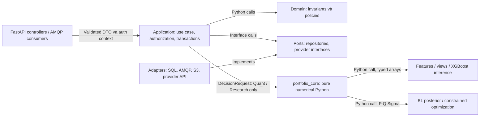

Không tách HTTP service cho từng XGBoost regressor hay mỗi phép tính BL. Quant và Research dùng cùng bản `portfolio_core` đã pin, nhưng có thể nâng version độc lập sau compatibility tests. Domain không import FastAPI/Celery/LLM SDK.

## 4. Công nghệ lựa chọn

| Lớp | Lựa chọn baseline | Lý do và giới hạn |
|---|---|---|
| Web | Next.js App Router, React, TypeScript | SSR/layout; client components cho chat/charts |
| UI/forms | Tailwind CSS, shadcn/ui, React Hook Form, Zod | Tokens, accessible primitives, typed validation |
| State/visuals | TanStack Query, native EventSource, Apache ECharts | REST cache, SSE, biểu đồ chuỗi thời gian |
| Backend | Python 3.12, FastAPI, Pydantic v2, Uvicorn | Phù hợp code Python và OpenAPI |
| SQL | PostgreSQL, SQLAlchemy 2, Alembic, psycopg | Database riêng theo service; pgvector chỉ Knowledge |
| Auth | Keycloak, OIDC Authorization Code + PKCE | Identity riêng, MFA admin, RBAC |
| Messaging | RabbitMQ quorum queues; Kombu integration consumers | Contract JSON AMQP liên service; durable delivery |
| Local long jobs | Celery worker pool trong service | Task names không là public integration contract |
| Cache/session | Redis HA, TLS; session store tách cache eviction | Cache có thể rebuild; session mất thì đăng nhập lại |
| Quant | NumPy, pandas, scikit-learn, XGBoost, CVXPY, OSQP/SCS | CPU serving, exact dependency/solver pinning |
| Storage/registry | S3; registry metadata do ML Platform sở hữu | JSON/UBJ model bundles, Parquet, immutable manifests |
| LLM/RAG | Hosted LLM + embedding qua provider adapters | Structured tool schemas; chọn model bằng eval tiếng Việt |
| Production | AWS EKS, RDS PostgreSQL Multi-AZ, S3, managed Redis | Reference deployment production có HA |
| Broker deployment | RabbitMQ Cluster Operator, 3 nodes / 3 AZ | Quorum queues, persistent volumes, topology spread |
| Delivery | Docker, Helm, Terraform, CI/CD theo service | Immutable images, migrations, rollout và rollback |
| Observability | OpenTelemetry, Prometheus, Grafana, Loki, Tempo | Trace xuyên HTTP/AMQP; metrics, logs |
| Tests | pytest/Hypothesis/Ruff, Vitest/Testing Library, Playwright, k6 | Numeric, contract, UI, E2E, load/failure tests |

AWS là **reference infrastructure được chọn để viết đặc tả**, chưa là quyết định mua dịch vụ. Dev dùng Docker Compose và S3-compatible local storage; staging phải chạy cùng topology/service boundaries để đánh giá HA. Không dùng Compose một máy làm môi trường production đích.

Chưa đưa MLflow vào critical path: registry domain nhỏ được xây trong ML Platform; có thể bổ sung tracking adapter sau, tránh hai nguồn production alias. Không cần PyTorch/TensorFlow/Ray/Triton cho XGBoost hiện tại. Daily data khởi đầu dùng PostgreSQL partitioned tables; chỉ thêm time-series extension/database nếu benchmark chứng minh cần.

Pin phiên bản qua lockfiles và image digests, không dùng `latest`. Không thay dependency của baseline nghiên cứu trước parity test. Chọn model LLM/embedding, vùng cloud, ngân sách và retention cuối cùng trong mốc nền tảng; API domain không phụ thuộc tên nhà cung cấp.

Nguồn xác minh khả năng nền tảng: [Next.js Server/Client Components](https://nextjs.org/docs/app/getting-started/server-and-client-components), [pgvector](https://github.com/pgvector/pgvector), [Keycloak OIDC](https://www.keycloak.org/securing-apps/oidc-layers), [Amazon EKS](https://docs.aws.amazon.com/eks/latest/userguide/what-is-eks.html).

## 5. Backend API

### 5.1. Quy ước chung

- Base path `/api/v1`; JSON UTF-8; OpenAPI là contract chuẩn để sinh TypeScript client.
- Resource IDs là UUID opaque; ngày giao dịch `YYYY-MM-DD`; timestamp RFC 3339 UTC. UI chuyển sang Asia/Ho_Chi_Minh.
- Decimal tiền/quantity/weights trả dưới dạng chuỗi; client chuyển để vẽ, không tự tính kết quả tài chính chuẩn.
- Pagination bằng cursor, mặc định 50, tối đa 200; sorting có allowlist.
- Request luôn có correlation `X-Request-ID`; propagation sang job/run/LLM call. Server không tin client-supplied user_id để xác định chủ sở hữu.
- Job dài trả `202 Accepted`, `job_id`, `status_url`, `events_url`. GET resource trả 200; tạo resource đồng bộ 201; accepted decision 200.
- Các POST tạo job, accept hoặc ledger entry yêu cầu `Idempotency-Key`; lưu hash body cùng kết quả. Cùng key/body trả kết quả trước; khác body trả 409.
- Resource mutable có `version` trả bằng strong ETag; PATCH và accept yêu cầu `If-Match` để tránh ghi đè. Với accept, token là portfolio ETag đã ghi trong recommendation response; service đối chiếu current portfolio version trong transaction. Thiếu precondition 428; version cũ 412.
- `401` chưa đăng nhập; `403` thiếu role; `404` cho resource không tồn tại hoặc không thuộc user; `422` invalid schema/domain; `409` infeasible/stale/conflicting request; `429` quota; `503` dependency unavailable.

Error envelope:

```json
{
  "error": {
    "code": "INFEASIBLE_CONSTRAINTS",
    "message": "Các giới hạn phân bổ hiện tại không tạo được danh mục hợp lệ.",
    "details": {"violations": ["sum_of_asset_caps_below_one"]},
    "retryable": false
  },
  "request_id": "req-example"
}
```

Với lỗi phát hiện sau HTTP 202, job chuyển FAILED với error envelope tương tự; GET job vẫn trả HTTP 200 cho resource job, không đổi hồi tố response thành 409.

API chỉ nhận proposal về policy/view từ client; backend validate và tạo snapshot cấu hình có quyền dùng. Không nhận một dict Python kwargs bất kỳ để truyền thẳng vào optimizer.

### 5.2. Danh mục endpoint

| Nhóm | Method / endpoint | Request chính → kết quả |
|---|---|---|
| Auth/BFF | `GET /auth/login`, `GET /auth/callback` | OIDC redirect và code exchange; đăng ký/reset password tại Identity UI |
| Auth/BFF | `POST /auth/logout`, `GET /auth/session` | Secure session cookie, CSRF; revoke session khi logout |
| Profile | `GET /me`, `PATCH /me` | Thông tin hiển thị và preference |
| Risk | `GET /risk-questionnaires/current` | Bộ câu hỏi, version, option IDs |
| Risk | `POST /risk-profiles/drafts`, `PATCH /risk-profiles/drafts/{id}` | Answers, goal, horizon, liquidity need → draft |
| Risk | `POST /risk-profiles/drafts/{id}/confirm`, `GET /risk-profiles` | Confirm → immutable profile version; danh sách versions |
| Assets | `GET /assets`, `GET /assets/{id}` | Asset class, unit, trading calendar, freshness, eligibility |
| Market | `GET /assets/{id}/prices`, `GET /market/status` | Date range/resolution → series + available_at/source/quality |
| Portfolio | `POST /portfolios`, `GET /portfolios`, `GET/PATCH /portfolios/{id}` | Name, PAPER/MANUAL, base currency, profile → draft/portfolio |
| Ledger | `POST /portfolios/{id}/transactions`, `GET /portfolios/{id}/transactions` | Deposit/withdraw/buy/sell/dividend/fee, quantity, price, effective_at; MANUAL records |
| Holdings | `GET /portfolios/{id}/holdings`, `GET /portfolios/{id}/valuations` | As-of → actual/projected-from-ledger positions and values |
| Optimize | `POST /portfolios/{id}/recommendations` | Profile version, strategy, cutoff, view IDs, constraints →202 job |
| Recommendation | `GET /recommendations/{id}`, `GET /recommendations/{id}/explanation` | Weights, evidence, freshness, diagnostics; explanation status |
| Decision | `POST /recommendations/{id}/accept`, `POST /recommendations/{id}/reject` | Expected portfolio version; accept lưu target, không tạo fill |
| Rebalance | `POST /portfolios/{id}/rebalance-proposals` | Trigger/requested constraints →202 proposal job; có thể NO_ACTION |
| Rebalance | `GET /rebalance-proposals/{id}`, `POST /rebalance-proposals/{id}/accept` | Drift, cost, trade plan; accept recheck versions/freshness |
| Paper execution | `POST /portfolios/{id}/paper-executions` | Accepted proposal/recommendation ID →202 execution simulation job |
| Views | `POST /views/drafts`, `PATCH /views/drafts/{id}`, `POST /views/drafts/{id}/confirm` | Legs, horizon, expected return, confidence, expiry |
| Views | `GET /views`, `POST /views/{id}/revoke` | Owner-visible confirmed views; revoke affects future runs |
| Chat | `POST /conversations`, `GET /conversations`, `GET /conversations/{id}/messages` | Conversation context and persisted messages |
| Chat | `POST /conversations/{id}/messages` | Content, client_message_id, optional portfolio_id →202 message + job |
| Jobs | `GET /jobs/{owner}/{id}`, `GET /jobs/{owner}/{id}/events`, `POST /jobs/{owner}/{id}/cancel` | Status, SSE, cooperative cancellation |
| Research | `POST /backtests`, `GET /backtests/{id}`, `GET /backtests/{id}/series` | Validated experiment definition →202; restricted quotas/role |
| Export | `POST /exports`, `GET /exports/{id}/download` | Portfolio/run IDs, format CSV/JSON →202; owner-authorized download |
| Admin data | `POST /admin/ingestions`, `GET /admin/data-quality` | Source/date range, data validation reports |
| Admin models | `POST /admin/trainings`, `GET /admin/models`, `POST /admin/models/{id}/promote` | Candidate training; atomic production alias update |
| Admin policies | `POST /admin/policies`, `POST /admin/policies/{id}/activate` | Validate/version policy; does not mutate existing runs |
| Admin RAG | `POST /admin/documents`, `GET /admin/documents` | Vetted files/allowlisted URLs → ingest/index job |
| Admin audit | `GET /admin/jobs`, `GET /admin/audit-events` | Filters by status, request_id, actor, date |
| Operations | `GET /health/live`, `GET /health/ready`, `GET /metrics` | Readiness/metrics; metrics chỉ mạng quản trị |

API paths ở trên là public façade của BFF; service ownership:

- Portfolio: me/risk/portfolios/ledger/recommendations/rebalance/views/policies và portfolio exports.
- Chat: conversations/messages/explanations; `GET /recommendations/{id}/explanation` route tới Chat, Chat kiểm tra quyền qua Portfolio.
- Market: assets/prices/status/ingestions/data-quality.
- ML Platform: trainings/models/promotions; Knowledge: documents; Research: backtests và research exports.
- Admin jobs/audit queries phải có `owner` filter thuộc allowlist; BFF có thể aggregate read-only responses có paging theo owner, không cross-DB query.
- Health/metrics là endpoint nội bộ từng service; không expose public metrics. Export request chỉ thuộc một owner domain: Portfolio cho portfolio data, Research cho experiment evidence.
- Internal APIs dùng prefix `/internal/v1`: Market snapshot manifests, ML registry manifests, Quant ready resolver/result reads, Portfolio delegation grants. Chúng chỉ nhận service identities/scopes đã cấp.

### 5.3. Contract tạo đề xuất

UUID dưới đây là dữ liệu minh họa, không phải resource hiện có. `as_of_date` được server resolve sang cutoff đã hoàn tất dữ liệu; client không tự chỉ định model production ID.

```json
{
  "risk_profile_version_id": "11111111-1111-4111-8111-111111111111",
  "strategy": "BL_ML",
  "as_of_date": "2026-09-24",
  "capital_vnd": "100000000",
  "universe_id": "VN30_GOLD_VFF",
  "confirmed_view_ids": [],
  "preferences": {
    "excluded_asset_ids": [],
    "max_position_weight": "0.30"
  }
}
```

Job result phải chứa hoặc tham chiếu:

```json
{
  "status": "SUCCEEDED",
  "recommendation_id": "22222222-2222-4222-8222-222222222222",
  "run_id": "33333333-3333-4333-8333-333333333333",
  "as_of_date": "2026-09-24",
  "valid_until": "2026-09-25T10:00:00Z",
  "strategy": "BL_ML",
  "engine_version": "app-v2",
  "data_snapshot_id": "snapshot-example",
  "model_bundle_id": "bundle-example",
  "policy_version_id": "policy-example",
  "allocation_url": "/api/v1/recommendations/22222222-2222-4222-8222-222222222222",
  "explanation_status": "PENDING",
  "degraded": false
}
```

Public strategy enum tách engine semantics và view mode: `EW`, `MVO`, `BL_RULE`, `BL_ML`, `BL_RANK_RELATIVE`, `HYBRID`. Versioned strategy config ánh xạ `BL_ML` mặc định sang `ranking_absolute`; không suy toàn bộ `BL_ML` là standard `ml` dispatcher cũ. HYBRID pin blend rule và MVO/BL component settings. API không cho client gửi arbitrary engine mode chưa được nghiệm thu.

Allocation resource chứa toàn bộ assets/weights với tổng 1, confidence **của views**, expected-return estimate kèm horizon, risk diagnostics, data freshness và warning codes. Không hiển thị confidence của view như xác suất danh mục sinh lời. Timestamps trong ví dụ minh họa schema; validity thực tế được tính theo calendar/policy.

### 5.4. Streaming chat qua SSE

Chọn REST POST để gửi nội dung và SSE GET để nhận sự kiện một chiều. SSE phù hợp luồng server→browser và hỗ trợ event IDs/reconnect; không cần WebSocket khi client gửi message qua REST. [MDN SSE](https://developer.mozilla.org/en-US/docs/Web/API/Server-sent_events/Using_server-sent_events).

- `POST message` trả `job_id`; frontend mở `GET /jobs/{owner}/{id}/events` bằng EventSource, cookie cùng origin.
- Content type `text/event-stream`, disable proxy buffering, heartbeat 15s, idle timeout 90s. Không đặt bearer token trong URL.
- Mỗi event có sequence tăng đơn điệu theo job; replay từ `Last-Event-ID`. `job_event` trong DB của owner service là nguồn bền vững, Redis chỉ đánh thức stream handler.
- Event types: `accepted`, `stage_changed`, `input_required`, `artifact_ready`, `text_delta`, `completed`, `failed`, `cancelled`.
- Persist text theo chunk 250ms hoặc 256 ký tự trước khi publish; không lưu từng token thành một transaction.
- Allocation card chỉ render dữ liệu đã kiểm định từ recommendation API. LLM explanation được kiểm tra grounding/numerical claims theo câu trước khi phát `text_delta`; khi không bảo đảm được, trả template. First response có thể là status event, không phải lời tư vấn đã hoàn tất.
- Disconnect không hủy job. Reconnect đọc replay; reload trang vẫn lấy final message từ DB. Hết retention event thì gửi `reset_required`, frontend tải snapshot/message hoàn chỉnh.

```text
id: 18
event: artifact_ready
data: {"type":"recommendation","id":"22222222-2222-4222-8222-222222222222"}

id: 19
event: text_delta
data: {"text":"Danh mục được tính từ hồ sơ rủi ro bạn đã xác nhận."}

id: 20
event: completed
data: {"message_id":"message-example","explanation_status":"VERIFIED"}
```

## 6. Điều phối workflow và xử lý lỗi

### 6.1. Chat yêu cầu phân bổ

```mermaid
sequenceDiagram
    actor U as Nhà đầu tư
    participant W as Web / BFF
    participant C as Chat Service
    participant P as Portfolio Service
    participant M as Market Data
    participant Q as Quant Serving
    participant MQ as RabbitMQ
    participant L as LLM provider

    U->>W: Gửi yêu cầu phân bổ
    W->>C: HTTPS POST message + auth + idempotency key
    C->>P: HTTPS issue limited delegation grant with current user auth
    P-->>C: Opaque grant reference for scoped async tools
    C->>C: SQL chat_db: message, job, outbox
    C-->>W: HTTP 202 + chat job
    W->>C: HTTPS GET job events (SSE)
    C->>L: HTTPS structured intent extraction
    L-->>C: Intent JSON
    C->>P: HTTPS scoped read: confirmed profile, portfolio
    P-->>C: Authorized versions và allowed actions
    alt Thiếu input hoặc view chưa xác nhận
        C->>C: SQL persist WAITING_INPUT
        C-->>W: SSE input_required + form schema
    else Input đã hợp lệ
        C->>P: HTTPS POST recommendation request + stable idempotency key
        P->>M: HTTPS resolve READY snapshot, freshness
        M-->>P: Immutable snapshot metadata
        P->>Q: HTTPS resolve compatible READY model and forecast
        Q-->>P: Pinned bundle / forecast IDs
        P->>P: SQL portfolio_db: saga input, job, outbox
        P-->>C: HTTP 202 + allocation_request_id
        P->>MQ: AMQPS optimize.requested qua outbox
        MQ->>Q: AMQPS command delivery
        Q->>Q: SQL inbox dedupe, persist local job
        Q->>Q: Read artifacts, DecisionEngine, validate constraints
        Q->>Q: SQL quant_db: run result + result outbox
        Q->>MQ: AMQPS optimization.succeeded
        MQ->>P: AMQPS result event
        P->>P: SQL inbox + check saga/version + recommendation + outbox
        P->>MQ: AMQPS recommendation.ready
        MQ->>C: AMQPS continuation event
        C->>P: HTTPS read authorized canonical recommendation
        P-->>C: Weights, evidence, freshness, diagnostics
        C->>C: SQL artifact event; schedule explanation
        C-->>W: SSE artifact_ready
        C->>L: HTTPS explain canonical result + sources
        L-->>C: Structured explanation
        C->>C: Check facts, persist verified text or template
        C-->>W: SSE verified text + completed
    end
```

Mỗi SQL transaction chỉ chạm DB của service đó. Outbox dispatchers và Celery nội bộ được lược khỏi sequence; không có worker chờ blocking `.get()` của worker khác. Chat lưu dependency trước khi gọi Portfolio; nếu crash sau HTTP success, retry cùng key lấy lại request cũ. Nếu event đến trước HTTP response, Chat xử lý bằng correlation ID đã lưu hoặc reconcile qua status API. Quant không tự ghi recommendation vào Portfolio DB.

### 6.2. Lifecycle job

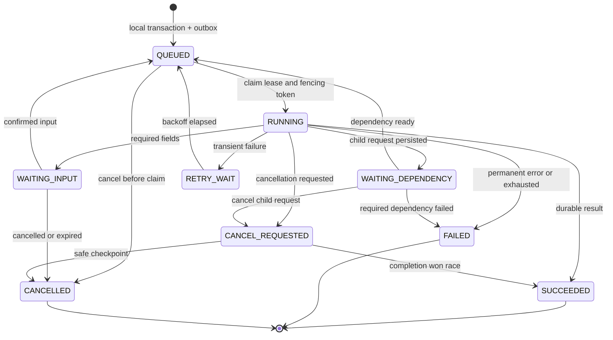

Local job có `owner_user_id, type, stage, attempt, max_attempts, lease_expires_at, fencing_token, input_hash, result_ref, error_code, deadline, version`. Mọi completion dùng compare-and-set trên attempt/fencing token; worker cũ không được overwrite retry mới. Recovery requeue expired lease, kiểm tra kết quả đã commit trước. Dependency wait có deadline và reconciliation loop; missing event không làm job treo vô hạn. RETRY_WAIT/WAITING_DEPENDENCY quá deadline chuyển FAILED; yêu cầu cancel ở RETRY_WAIT chuyển CANCELLED. Cần kiểm thử các transition này dù sơ đồ lược bớt cạnh.

Job thuộc service nào được service đó authorize/status/stream/cancel; BFF không giữ một bảng job chung có thể lệch trạng thái. `/jobs/{owner}/{id}` chỉ map owner allowlist sang service route nội bộ. Parent saga có thể hiển thị tiến độ con bằng projection từ events.

### 6.3. Contract sự kiện, delivery và bảo mật

Ví dụ envelope tích hợp; payload production dùng UUID thật và hash đầy đủ:

```json
{
  "event_id": "44444444-4444-4444-8444-444444444444",
  "type": "quant.optimization.succeeded",
  "schema_version": 1,
  "producer": "quant-serving",
  "occurred_at": "2026-09-25T08:00:00Z",
  "correlation_id": "55555555-5555-4555-8555-555555555555",
  "causation_id": "66666666-6666-4666-8666-666666666666",
  "aggregate_id": "77777777-7777-4777-8777-777777777777",
  "aggregate_version": 3,
  "traceparent": "00-4bf92f3577b34da6a3ce929d0e0e4736-00f067aa0ba902b7-01",
  "payload": {
    "allocation_request_id": "55555555-5555-4555-8555-555555555555",
    "run_id": "33333333-3333-4333-8333-333333333333",
    "input_hash": "sha256:example",
    "result_artifact_id": "artifact-example"
  }
}
```

- Public command/event schemas lưu JSON Schema và AsyncAPI theo version; additive changes backward-compatible, breaking changes đổi major và dual-read trong migration.
- Exchange tách `commands` và `events`; queues theo consumer domain. Routing ví dụ `quant.optimize.v1`, `market.dataset.published.v1`, `ml.model.published.v1`, `portfolio.recommendation.ready.v1`.
- Liên service dùng Kombu consumer JSON với inbox/outbox. Celery chỉ chạy local jobs đã được service ghi nhận; không dùng Python task names/pickle làm public bus contract.
- Consumer commit inbox + local job/outbox trước ack. Heavy work chạy sau; event result commit vào local outbox. Delivery **at least once**; dedupe event ID và unique logical stage/input hash. Publisher confirms và consumer acknowledgements giải quyết hai chặng khác nhau. [RabbitMQ confirms](https://www.rabbitmq.com/docs/confirms).
- Quorum queues durable, persistent messages, 3 broker nodes. Retry queues/backoff, dead-letter queue có lý do và cảnh báo; không infinite requeue. [RabbitMQ quorum queues](https://www.rabbitmq.com/docs/quorum-queues).
- Không giả định global event order. Consumer kiểm tra aggregate version; event cũ bỏ qua, version gap reconcile qua API owner. Immutable data revisions không bị event đến trễ ghi đè.
- Service identities có publish/consume ACL theo queue/exchange. Broker network private, AMQPS; payload không chứa bearer token, raw conversation, credentials hay full user profile.
- Optimize command chứa validated immutable input snapshot đủ cho phép tính và owner reference tối thiểu. Quant chỉ nhận từ Portfolio/Research identity có scope tương ứng; không chấp nhận user ID tùy ý từ public client.
- Celery local tasks idempotent trước khi bật late ack/reject-on-worker-lost. Local dispatch qua outbox cũng cần publisher confirms. [Celery tasks](https://docs.celeryq.dev/en/stable/userguide/tasks.html).

### 6.4. Allocation saga, retry và compensation

1. Portfolio authorize user, freeze profile/policy/views/holdings version; resolve snapshot và compatible READY bundle. Persist canonical input + hash.
2. Quant xử lý input immutable, ghi run/result/outbox; retry không tạo nhiều canonical result cho cùng logical request.
3. Portfolio nhận result, đối chiếu request/hash/versions/constraints. Nếu user đã đổi profile/holdings, có thể giữ kết quả để xem với trạng thái `SUPERSEDED`, không cho accept.
4. Chat giải thích sau recommendation.ready. Không rollback allocation khi LLM lỗi.
5. Accept trong Portfolio DB transaction kiểm tra owner, recommendation status/expiry, portfolio version và idempotency; tạo allocation target version và audit cùng transaction.
6. Cancellation đánh dấu saga, gửi cancel command; result đến trễ vẫn lưu evidence nhưng không tự chấp nhận. Không cần “compensate” bằng bán tài sản vì workflow này chưa tạo giao dịch.

Initial deadlines: dependency HTTP read 3 s, quant 60 s, explanation 45 s, ingestion 15 phút, train/backtest tối đa 2 giờ theo quota. Transient network/429/5xx retry tối đa 3 lần, exponential backoff + jitter, tôn trọng Retry-After; deadline tổng ưu tiên hơn số retry. Validation, unauthorized, infeasible không retry. Admin replay DLQ tạo attempt mới có audit và giữ original ID; không sửa âm thầm payload cũ.

### 6.5. Failure policy

| Tình huống | Hành vi |
|---|---|
| LLM lỗi / nội dung không grounded | Template từ canonical facts; form và allocation tiếp tục hoạt động |
| Không có ML bundle compatible | Prior-only BL chỉ nếu policy cho phép; gắn DEGRADED; không ngụy tạo forecast |
| Không có views | app-v2 dùng prior-only; legacy-v1 giữ historical-mean fallback để tái lập |
| Giá thiếu/cũ hoặc snapshot quarantine | Không tạo recommendation mới có thể accept; hiển thị stale reason |
| Solver infeasible | Trả constraint diagnostics; không tự nới giới hạn |
| Solver numerical failure | Thử solver đã nghiệm thu, revalidate; nếu vẫn lỗi thì FAILED |
| Quant/ML service gián đoạn | Jobs pending có deadline; training lỗi không đổi production alias |
| Chat gián đoạn | Direct portfolio form vẫn hoạt động; giải thích được tiếp tục sau |
| Cache Redis lỗi | Derived data đọc từ owner DB/artifacts; SSE poll local event table |
| Session Redis lỗi | Không bypass auth; session requests fail closed hoặc đăng nhập lại sau phục hồi |
| RabbitMQ lỗi | Outbox giữ job bền vững; backpressure/quota; trả trạng thái delayed, không hứa đang chạy |
| Một service DB lỗi | Readiness fail, mutation của service đó dừng; circuit breaker hạn chế lan lỗi |
| S3 lỗi/checksum sai | Không dùng model/dataset chưa xác thực; bundle đã verify trong memory có thể tiếp tục trong freshness policy |

Không dùng FastAPI BackgroundTasks cho train/backtest; heavy compute chạy worker process riêng. [FastAPI guidance](https://fastapi.tiangolo.com/tutorial/background-tasks/).

## 7. Đóng gói lõi giai đoạn 1 và model serving

### 7.1. Cấu trúc repository đề xuất

```text
apps/web/                          # Next.js / BFF
services/
  portfolio/                       # src/domain, application, adapters, api, workers
  chat/
  market-data/
  quant-serving/
  ml-platform/
  knowledge/
  research/
  # mỗi service: pyproject, lockfile, Dockerfile, migrations, tests, Helm values
packages/
  portfolio-core/                  # numerical library versioned
  contracts/                       # OpenAPI, AsyncAPI, JSON Schemas, generated clients
  observability/                   # small common tracing package
research/experiments/
infra/
  local/                           # Compose
  terraform/                       # VPC, EKS, RDS, S3, IAM
  helm/                            # deployments, queues, autoscaling, monitoring
docs/adr/
docs/thesis-evidence/
tests/contract/
tests/e2e/
tests/load/
```

Monorepo không đồng nghĩa chung deployment. Build matrix theo changed paths; shared core phát version nội bộ, từng service chủ động nâng lockfile. Không share SQLAlchemy ORM entities/repositories giữa service. Identity dùng deployment Keycloak, không viết authentication service riêng bằng Python.

Migration code hiện tại tăng dần: wrapper → parity fixtures → extract pure core → legacy CLI facade. Chưa di chuyển source trong nhiệm vụ viết đặc tả này.

### 7.2. Contract lõi

```python
class DecisionEngine:
    def allocate(self, request: DecisionRequest) -> DecisionResult: ...

class ForecastProvider:
    def predict(self, request: ForecastRequest) -> ForecastBundle: ...

class MarketDataRepository:
    def load_snapshot(self, snapshot_id: str, cutoff: datetime) -> MarketSnapshot: ...

class ArtifactStore:
    def read_verified(self, uri: str, sha256: str) -> bytes: ...
```

Đây là pseudo-interface để thiết kế, không phải code sản phẩm đã chạy.

`DecisionRequest`: ordered asset IDs, cutoff/decision/execution times, data snapshot, model/feature/policy versions, strategy, validated views, current holdings/weights, costs, capital, seed, engine semantics version. Không truyền DataFrame không có asset/date schema.

`DecisionResult`: ordered target weights, prior/posterior means, covariance reference, P/Q/confidence/Omega reference, view provenance, regime, solver/status/objective, constraint residuals, estimated costs/turnover, diagnostics và artifact hashes. Confidence clamp, đơn vị return, horizon và annualization convention được lưu rõ.

### 7.3. Mapping từ code hiện tại

| Source | Hướng đóng gói |
|---|---|
| `gen_view/xgboost/xgboost_core.py` | Tách training và inference adapters; feature builder dùng chung; immutable bundle |
| `gen_view/ranking/stock_selection.py` | Selection module thuần trong Quant/Research; cache theo snapshot/universe/cutoff/K/algorithm_version |
| `gen_view/ranking/ranking_model.py` | Optional relative-ranking ForecastProvider sau khi xử lý lookback compatibility |
| `gen_view/view_generators.py` | ViewFactory + unit conversion + P/Q assembly; không gắn API/DB |
| `gen_view/ranking/risk_management.py` | RegimeDetector + explicit asset-class policy |
| `backtest/_black_litterman.py` | Posterior calculator, daily scale thống nhất |
| `backtest/_optimizer.py` | Optimizer trả diagnostics và feasible flag; không chỉ ndarray |
| `backtest/_ranking_helpers.py`, `_loop.py` | Extract shared one-step DecisionEngine; backtest chỉ quản lý timeline/holdings/valuation |
| `backtest/_prediction.py` | Thay bằng shared DecisionEngine; không dùng nguyên trạng cho ranking_absolute |
| `utils/data_loader.py` | CSV adapter cho import/research; DB/snapshot adapter cho ứng dụng |
| `utils/view_logger.py` | RunArtifactWriter; nhận output path và run ID từ caller |
| `crawl/*.py` | Provider adapters theo asset/date range; bỏ batch offset hardcode và import-time side effects |

Thay module-level mutable config bằng immutable `EngineConfig` theo request. Không monkey-patch global constants theo user: nhiều request đồng thời có thể lẫn policy. Các legacy CLI vẫn dùng config mặc định qua adapter.

### 7.4. Train, publish và serve

- Train là scheduled/admin job; request người dùng chỉ dùng model đã publish. Refresh dữ liệu không mặc nhiên train lại mỗi lần.
- Lịch mặc định: mỗi phiên dữ liệu hoàn tất tạo snapshot và forecast; train mỗi 10 phiên đủ dữ liệu; representative selection mỗi 20 phiên. Universe/policy/cutoff khác phải có cache identity riêng.
- Train bundle cho universe hợp lệ, ưu tiên toàn bộ 30 stock để sẵn model cho cổ phiếu mới được chọn. Đây là thay đổi so với train selected-only; phải đo chi phí và parity trước khi dùng. Asset không đủ history có trạng thái unavailable, không forecast bằng zero.
- Bundle là immutable collection gồm model files, scaler parameters, feature schema, asset coverage, training/validation ranges, knowledge cutoff, data hash, code commit, dependency lock hash, seeds và validation report.
- XGBoost lưu JSON/UBJ; scaler lưu mảng mean/scale/variance + feature order/schema để dựng phép biến đổi tương đương. Không tải pickle không kiểm soát vào serving. XGBoost phân biệt model IO ổn định với memory snapshot/pickle phụ thuộc phiên bản. [XGBoost Model IO](https://xgboost.readthedocs.io/en/stable/tutorials/saving_model.html).
- Registry: `CANDIDATE → VALIDATED → PRODUCTION → RETIRED`; failed candidate giữ report. Một production alias có generation tăng đơn điệu cho mỗi task/universe/schema; promotion cần scope model-reviewer và validation gate.
- Production alias update atomic. Run pin bundle ID khi tạo; request đang chạy không đổi model giữa chừng. Rollback chỉ chuyển alias về bundle compatible đã duyệt.
- Worker đọc bundle vào memory cache theo ID/checksum; BL/CVXPY chạy Python trong quant worker. Chưa cần Triton/Ray Serve hoặc HTTP service cho mỗi regressor.
- Giới hạn native threads XGBoost/BLAS theo CPU quota để các worker không oversubscribe. Benchmark exact selection trước khi đưa vào SLA; precompute và cache thay vì hứa response nhanh vô điều kiện.

### 7.5. Data-to-serving workflow

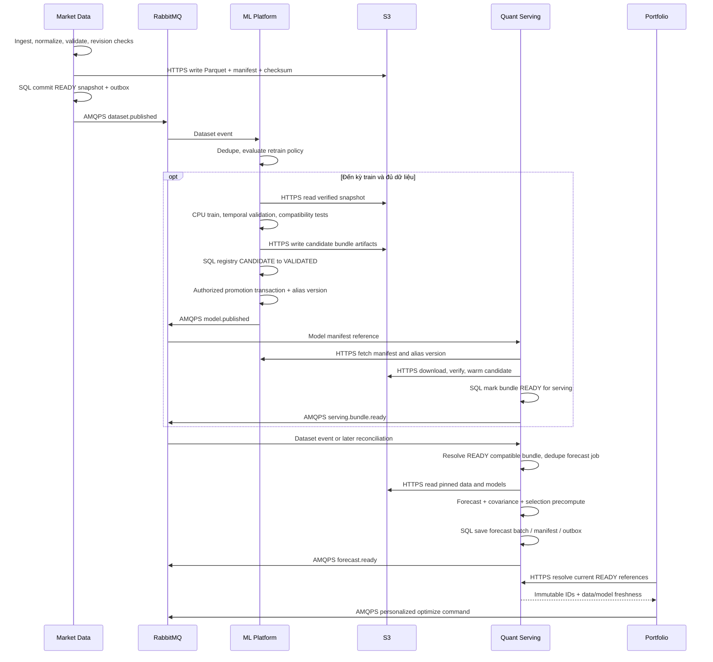

Dataset/model events có thể đến bất kỳ thứ tự. Quant reconciliation chỉ tạo forecast khi đủ cặp tương thích; dedupe theo snapshot + bundle + feature/selection config. Promotion ở registry chưa đồng nghĩa bundle đã sẵn trên serving. Resolver chỉ trả bundle READY, còn trong freshness policy và là alias generation hiện hành đã được chấp thuận. Trong rollout có thể dùng version trước đã duyệt; mọi run pin chính xác ID. Rollback phát alias version mới; Quant không cho event cũ đưa model đã retire trở lại.

Artifacts upload trước, verify checksum, rồi transaction commit manifest READY và outbox; object mồ côi do rollback được dọn theo lifecycle. Không coi upload S3 và SQL commit là cùng một transaction.

### 7.6. Các sửa đổi bắt buộc trước serving

1. Chuẩn hóa forecast/decision/execution time; feature chỉ đọc dữ liệu đã available tại cutoff; phục vụ và train dùng cùng feature-history semantics.
2. Sửa ranker lookback 40 so với features 60; kiểm tra NaN và đủ history trước prediction.
3. Tách equity/gold/bond/cash bằng metadata; không suy `stock = not defensive` như hiện tại.
4. Kiểm tra constraints sau thresholding/blending/rounding; không chấp nhận solver fallback vi phạm giới hạn.
5. Tách `legacy-v1` và `app-v2`: daily unit, lambda convention, no-view fallback và daily weight drift đều có version, không âm thầm thay đổi các bảng cũ.
6. Backtest/app dùng cùng policy và one-step decision path; no-look-ahead tests cho prices/returns offset, label horizon và validation purging.
7. Cố định source units; GOLD full_path; calendar ngày nghỉ; price staleness; model artifact schema.

### 7.7. Research serving và historical retraining

Live inference dùng production bundles có sẵn; historical walk-forward trong Research phải replay lịch training tại từng cutoff. Không lấy current production model huấn luyện đến năm sau để dự báo lịch sử. Research worker gọi cùng versioned trainer/core trên dữ liệu cắt thời gian, lưu candidate bundles trong research-owned artifact prefix và model schedule manifest; không cập nhật production alias. Tái sử dụng historical ML Platform bundle chỉ khi knowledge cutoff, feature schema và temporal protocol khớp.

Hai cache tách namespace: online approved models và research experiment models. Live model selection/retraining cadence cần đo so với research protocol; forecast cho GOLD/VFF có thể là ML hoặc policy views tùy strategy, phải ghi coverage/provenance thay vì chỉ train 30 stocks rồi giả định đủ mọi asset.

## 8. Cá nhân hóa và tái cân bằng

### 8.1. Risk policy compiler

Profile giữ answers, scoring_version, score/level, investment horizon, target return, drawdown tolerance, liquidity needs và exclusions. LLM giúp diễn đạt/trích xuất; scoring là deterministic rule, người dùng xác nhận trước khi active.

Policy compiler chuyển profile version + system policy thành: permitted assets, position cap, equity cap, bond/cash floor, risk aversion, turnover limit, min trade và cost assumptions. Các preset conservative/balanced/aggressive phải được hiệu chỉnh bằng IS và freeze trước OOS; không gán con số chưa đánh giá rồi gọi là phù hợp khách hàng. UI luôn có form chỉnh preference trong phạm vi policy; không cho user thay solver hay bỏ kiểm định.

- Horizon đầu tư của user không đổi target 5-ngày của model; cần retrain/evaluate bundle mới để đổi prediction horizon.
- Forecast/covariance có thể dùng chung theo snapshot; **final weights chỉ cache khi toàn bộ personalized inputs khớp**.
- Cache key gồm user/portfolio scope, profile version, policy, holdings version nếu có cost/turnover, universe/exclusions, confirmed views, snapshot, bundle, strategy, cutoff, engine version và capital nếu rounding/cost phụ thuộc vốn.
- Key là hash canonical input; TTL không thay cho freshness check. TTL đề xuất 15min cho result pointer; database record và artifact immutable tồn tại dài hơn.

### 8.2. Ràng buộc allocation

`app-v2` tối ưu long-only, budget 1, position/class bounds theo policy; explicit GOLD class; costs/turnover đưa vào objective hoặc constraint với coefficient đã version hóa. Chuẩn daily return/covariance giữ như code, viết rõ objective `mu^T w - lambda*w^T Sigma*w - cost_penalty(w,w_current)`.

Cost penalty phải cùng đơn vị với objective: với daily mean/covariance, dùng estimated one-off cost chia portfolio capital rồi phân bổ theo planned holding horizon H phiên, hoặc chuyển toàn objective sang H-session scale trong strategy version. Không cộng phí VND trực tiếp vào daily return; lưu H và cost coefficient để backtest/serving dùng cùng convention.

Cash VND là synthetic asset/account: cash ledger dùng quantity theo đơn vị VND, mark price = 1. Nếu đưa cash vào optimizer, expected daily cash return dùng explicit policy rate và covariance bằng 0 trong formulation; không fit XGBoost cho cash. Baseline có thể tối ưu risky assets trước rồi giữ rounding residual ở cash, nhưng vẫn phải kiểm tra policy trên executed portfolio gồm cash. Chọn một convention cho mỗi strategy version, không tự chuyển giữa hai cách.

HYBRID chỉ là candidate allocation. Sau blend, phải giải phép projection về feasible set nếu cần, rồi revalidate; ghi cả before/after và objective impact. Phép projection là thay đổi thuật toán cần ablation; bản nghiên cứu legacy giữ cách cũ để so sánh. Nếu không có feasible solution thì không tạo recommendation ACCEPTABLE.

Invariant: asset order nhất quán; số hữu hạn; sum weights sai số≤1e-6; weights≥-1e-8; class/position/turnover residuals≤1e-6 trước rounding. Sau rounding giao dịch, recheck trên projected executed holdings và giữ phần dư ở cash. Không hứa exact target khi có lot/min subscription constraints.

### 8.3. Holdings và valuation

- Holdings là projection từ ledger buy/sell/deposit/withdraw/dividend/fee/corporate-action; quantity giữ nguyên giữa giao dịch, weight biến động theo giá.
- Cash có ledger riêng theo base currency. Portfolio tổng giá trị = cash + tổng quantity×raw mark price×unit multiplier; nếu dùng price_vnd đã normalize thì không nhân multiplier lần nữa.
- PAPER ledger chỉ do simulation engine ghi; MANUAL ledger do người dùng ghi nhận có timestamp và nguồn. Correction tạo reversal + replacement, không xóa lịch sử.
- PAPER execution dùng giá hợp lệ đầu tiên **sau decision cutoff**, phí/lot/slippage version hóa. Với quỹ, execution theo NAV công bố tiếp theo phù hợp dealing policy; không giả định mua được NAV trước khi biết giá. Đánh dấu mô hình fill đơn giản hóa.
- Valuation holdings thực ưu tiên unadjusted tradable prices và corporate-action ledger. Total-return backtest có thể dùng adjusted close nhưng không cộng cổ tức/split lần nữa; nếu chỉ có adjusted close, không suy đó là execution price thực tế. Chọn và lưu price adjustment convention theo asset/snapshot. GOLD mark dùng midpoint khi có buy/sell, paper buy ở ask/sell ở bid; dữ liệu thiếu spread phải ghi cost assumption.
- MANUAL NAV chỉ được gọi là thực tế theo dữ liệu người dùng, không là số liệu xác thực từ broker. Thiếu lịch sử giao dịch thì hiển thị không đủ dữ liệu, không bịa đường NAV.

### 8.4. Rebalance workflow

Drift: `max_i(abs(current_weight_i - target_weight_i))`; turnover chuẩn `0.5*sum_i(abs(proposed_weight_i-current_weight_i))`, bao gồm cash. Trigger mặc định đề xuất 5 điểm phần trăm hoặc mỗi 5 phiên; là config sản phẩm cần backtest, không khẳng định tối ưu.

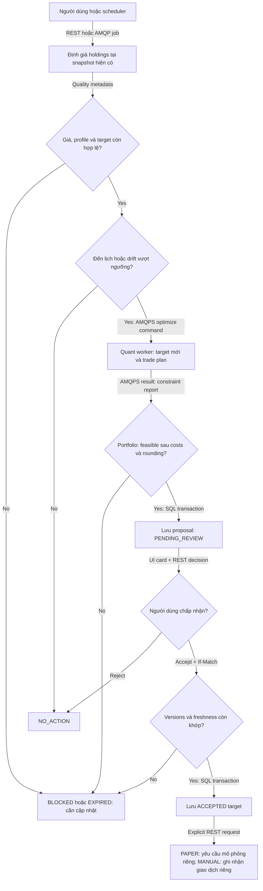

PAPER execution worker kiểm tra portfolio/account còn active và execution request vẫn được phép trước khi ghi ledger. MANUAL fills luôn qua API ownership/current authorization.

Không dùng expected-return improvement như lợi ích chắc chắn để quyết định costs. Có thể áp dụng no-trade band/min trade/turnover cap đã kiểm định, đồng thời hiển thị sensitivity theo cost assumptions.

## 9. Thiết kế dữ liệu và ERD

### 9.1. Quy tắc sở hữu và kiểu dữ liệu

Mỗi ERD biểu diễn quan hệ **trong database owner**. Các trường `asset_id`, `user_id`, `run_id`, `snapshot_id`, `model_bundle_id` trỏ sang service khác chỉ là external reference, không là SQL FK liên database. API/event validation và immutable snapshots bảo đảm hợp lệ nghiệp vụ; local projections có source version và sync timestamp.

- ID: UUID; timestamp: `timestamptz`; ngày giao dịch: `date`.
- Tiền VND `numeric(24,4)`, quantity `numeric(28,10)`, weight/coefficient `numeric(18,10)`; Python numerical engine dùng float64, kiểm tra finite/tolerance trước persistence.
- Dữ liệu có thể thay đổi có `version bigint`; immutable versions không UPDATE nội dung. Common columns: `created_at, updated_at`; owner-bound records có `owner_user_id`.
- JSONB dùng cho validated questionnaire answers, configs và diagnostics có schema version; không thay relational keys, weights và ledger bằng một JSON khổng lồ.
- Artifact chứa ma trận/series lớn, DB chứa manifest/hash/version; không serialize NumPy hoặc pickle vào response.
- Identity credentials chỉ nằm trong Keycloak. `APP_USER.identity_subject` ánh xạ OIDC `issuer + sub`; Portfolio cấp business user UUID, các service khác lưu reference.

### 9.2. Portfolio database: người dùng, views và phân bổ

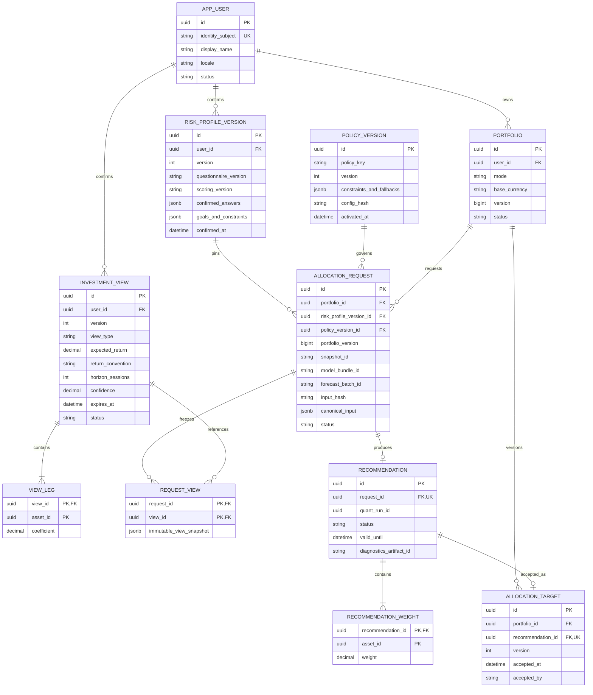

`input_hash` bao gồm owner/portfolio và semantics, được index để tìm cached computations; không unique toàn hệ thống. Request identity dùng `UNIQUE(owner_user_id, route, idempotency_key)`; cho phép chủ động tạo request mới với cùng input. Dedupe computations không làm hai người dùng dùng chung recommendation record.

Drafts nằm trong `risk_profile_draft`, `view_draft`, có expiry/version; confirm tạo immutable version mới. Revocation cập nhật lifecycle metadata, không thay nội dung view đã pin trong run. `questionnaire_version` lưu definitions/scoring schema riêng. `portfolio_risk_binding` ghi version profile hiện hành và lịch sử hiệu lực; accept so với binding hiện tại.

### 9.3. Portfolio database: ledger, holdings và rebalance

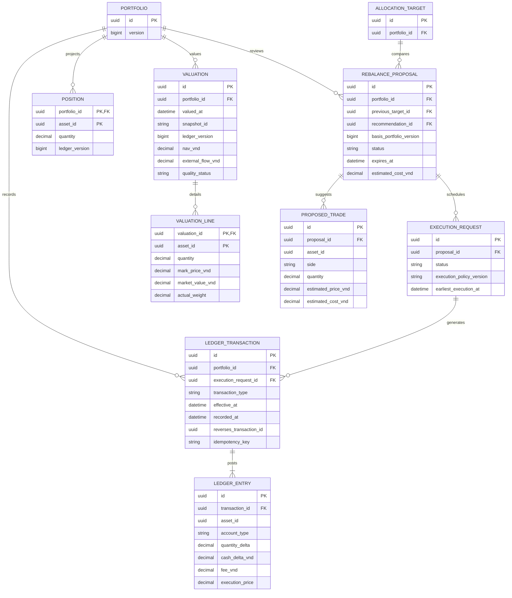

Nullable `execution_request_id` dành cho MANUAL records hoặc deposit không bắt nguồn từ PAPER execution. Initial accepted recommendation tạo proposal với previous target nullable để dùng cùng execution path; không tạo fills trực tiếp khi accept target.

Ledger entry quy định rõ asset leg và cash/fee legs để không cộng phí hai lần; transaction validator kiểm tra lượng mua/bán, biến động cash, no-negative-position/cash theo policy. Correction bằng reversal+replacement. Backdated MANUAL entry tăng ledger version, đánh dấu valuation từ effective date là cần rebuild; rebuild atomically đổi projection version. Corporate actions có external event ID unique để không áp dụng hai lần.

Giá trị quantity/asset legs không phải đơn vị kế toán tiền tương đương; không áp đặt “tổng quantity bằng 0”. Nếu triển khai double-entry accounting đầy đủ, cần chart of accounts và valuation rules riêng; bản này dùng investment ledger có invariant tường minh.

### 9.4. Market database

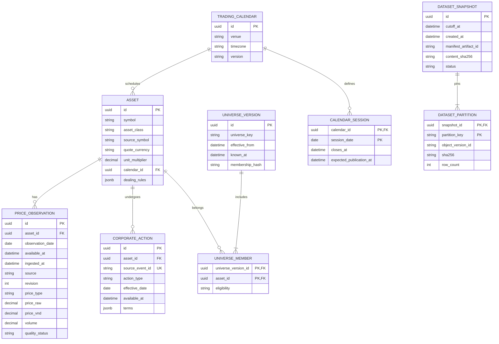

Price uniqueness: `(asset_id, observation_date, price_type, source, revision)`; latest materialized view là convenience, không dùng để tái lập run cũ. OHLC/bid/ask/NAV/adjusted-close có price_type riêng, không thay nhau ngầm. Index `(asset_id, observation_date DESC, available_at)`, partition theo observation month/year tùy benchmark; BRIN cho time scan lớn. Primary/unique keys trên bảng partitioned phải bao gồm partition key hoặc dùng parent metadata key phù hợp migration.

Snapshot manifest liệt kê **đúng revisions và universe/calendar versions**; chỉ giữ cutoff filter là chưa đủ khi source sửa dữ liệu quá khứ.

### 9.5. ML database và Quant database

Hai nhóm trong cùng code block để tiện đối chiếu, **không có cạnh FK giữa hai owner**.

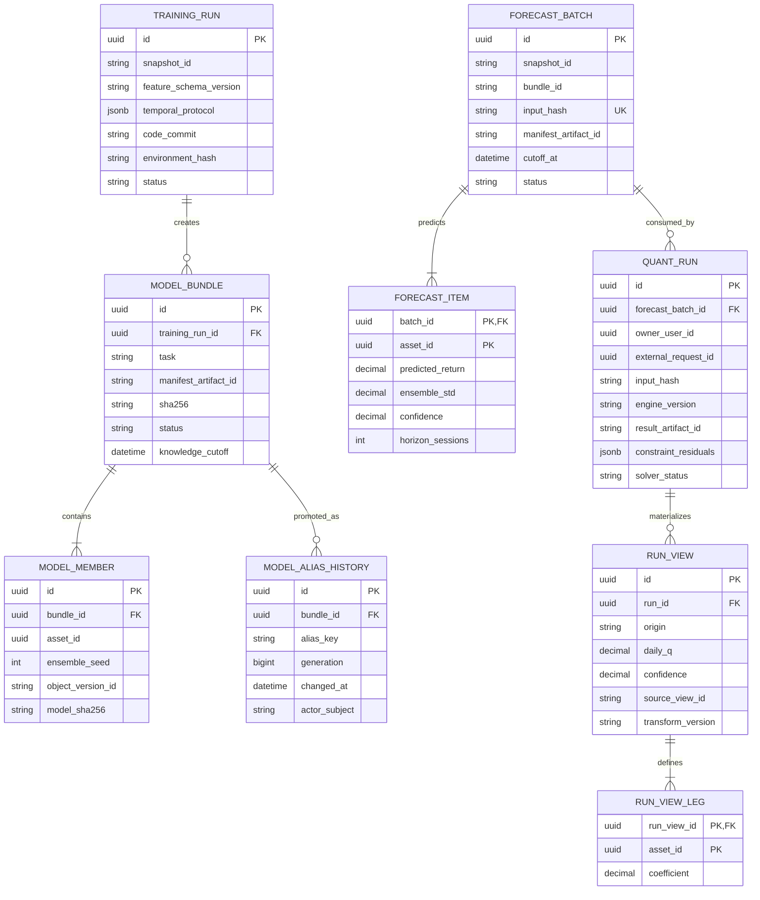

ML owner: TRAINING_RUN, MODEL_BUNDLE, MODEL_MEMBER, MODEL_ALIAS_HISTORY và current alias table `model_alias(alias_key PK, bundle_id FK, generation)`. Quant owner: FORECAST_BATCH/ITEM, QUANT_RUN, RUN_VIEW/LEG, `serving_bundle` projection, `selection_snapshot`, covariance manifests. Prior-only run cho phép forecast_batch_id null. Unique forecast input hash bao gồm snapshot, bundle, ordered universe, cutoff và toàn bộ transform config, nên có thể dùng chung hợp lệ giữa users.

Registry states thể hiện quá trình duyệt; alias mới quyết định bundle hiện hành. Một bundle có thể phục vụ nhiều aliases, không suy “PRODUCTION status” là duy nhất toàn bộ registry.

### 9.6. Chat, Knowledge và Research databases

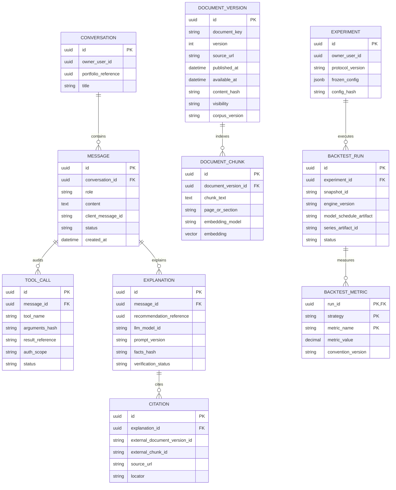

Chat sở hữu 5 bảng đầu; Knowledge sở hữu DOCUMENT_VERSION/CHUNK; Research sở hữu EXPERIMENT/BACKTEST_RUN/METRIC. Citation giữ reference và metadata nguồn đủ để truy nguyên khi corpus thay đổi; copy excerpt tối thiểu vào immutable explanation evidence theo quyền lưu trữ. Không tạo FK từ Chat tới Knowledge. Embedding dimension/model đổi thì tạo index version mới, không trộn các không gian embedding.

### 9.7. Bảng vận hành dùng chung về cấu trúc, riêng về dữ liệu

Mỗi owner service triển khai các bảng sau trong DB riêng; không dùng một operational database có quyền ghi từ mọi service.

| Bảng | Trường và invariant chính |
|---|---|
| `job` | status/stage/owner/attempt/deadline/lease/fencing/version/result_ref như mục 6 |
| `job_event` | PK(job_id, sequence), type, payload, created_at; append-only, phục vụ SSE |
| `outbox_event` | event_id PK, aggregate/version, schema, payload, publish_state, lease, retry_at |
| `inbox_event` | PK(consumer_name, event_id), processed_at, result; cùng transaction domain mutation |
| `idempotency_record` | unique(owner, route, key), body_hash, response/status/ref, expires_at |
| `artifact_manifest` | id, owner, storage_key, version_id, sha256, media_type, size, schema_version, status |
| `audit_event` | actor, scope, action, object_id, redacted before/after hashes, request/trace IDs, timestamp |
| `schedule_run` | unique(schedule_key, logical_fire_time), lease và status; chống hai scheduler chạy cùng kỳ |

Index theo `owner_user_id, created_at DESC`, `job(status, next_attempt_at)`, `outbox(publish_state, retry_at)`; partial index cho pending. SSE replay index(job_id, sequence). Chat unique(conversation_id, client_message_id). Accept/ledger idempotency là durable business uniqueness lâu dài; HTTP response cache retention 24 giờ không đủ để chống giao dịch lặp nhiều ngày sau.

Portfolio có thêm `delegation_grant` như mục 14; opaque grant lookup chỉ chấp nhận authenticated actor service.

Portfolio tổng weights = 1 là invariant nhiều rows: kiểm tra trong transaction trước READY/ACCEPTED, có thể thêm deferred constraint trigger. Không viết CHECK giả vờ kiểm tra tổng của các row khác; PostgreSQL CHECK có giới hạn loại ràng buộc này. [PostgreSQL constraints](https://www.postgresql.org/docs/current/ddl-constraints.html).

Migrations do từng service sở hữu. Dùng expand → backfill → switch readers → contract; không xóa column/enum khi consumer cũ còn chạy. DB user runtime không có quyền migration. Có thể bổ sung RLS cho bảng owner-bound, runtime role không là owner/bypass role; connection-pool context phải SET LOCAL trong transaction và reset. RLS là lớp bổ sung, không thay authorization ở API. [PostgreSQL row security](https://www.postgresql.org/docs/current/ddl-rowsecurity.html).

## 10. Data engineering và numerical contract

### 10.1. Thu thập và chất lượng dữ liệu

Market Data chạy ingestion theo lịch công bố thực tế của từng nguồn. Baseline adapter tái sử dụng vnstock cho stocks/funds và PNJ cho gold; đổi source phải lưu source version, điều kiện sử dụng và data quality report. Không mặc định nguồn miễn phí nghiên cứu có SLA/phạm vi sử dụng production; đánh giá provider trong mốc nền tảng.

Pipeline: fetch raw → lưu raw artifact/hash → normalize units/timezone → validate → quarantine hoặc revision insert → xây immutable snapshot → publish. Retry theo source quota; fetch bằng asset/date range, bỏ hardcoded batch offsets.

Các kiểm tra bắt buộc:

- Uniqueness, monotonic sessions, giá dương/hữu hạn, OHLC hợp lý nếu có; lịch nghỉ/phiên thiếu.
- Dữ liệu công bố muộn và nguồn sửa giá là hai tình huống khác nhau; giữ `observation_date, available_at, ingested_at, revision`.
- Outlier check chỉ cảnh báo/quarantine theo rule; không tự xóa biến động thật. Corporate actions/adjusted close cần reconcile.
- Unit normalization: stock quote unit, fund NAV đã chia 1000 trong crawler hiện tại, GOLD unit/lot riêng. Không nhân thêm 1000 hai lần; raw values và conversion version phải lưu.
- Stale NAV và gold không được forward-fill vô hạn. Đề xuất stale threshold theo **expected publication sessions** của từng asset; Market trả freshness state. Missing asset bắt buộc khiến run blocked hoặc tạo universe variant rõ ràng có user/policy cho phép.
- Trading calendar dùng venue metadata và publication schedule; thay `freq="B"` mặc định. Lịch định giá danh mục có thể chung nhưng phải giữ stale flags của từng mark.
- Universe VN 30 point-in-time cần effective date và known_at. Nếu chỉ có danh sách hiện tại áp cho quá khứ, đánh dấu survivorship bias trong thực nghiệm, không gọi đó là historical constituent backtest.

### 10.2. Công thức và đơn vị phải version hóa

BL hiện tại:

```text
pi = delta * Sigma_daily * w_prior
Omega = diag(diag(P * (tau * Sigma_daily) * P^T) / confidence)
mu_BL = solve(
    inverse(tau * Sigma_daily) + P^T * inverse(Omega) * P,
    inverse(tau * Sigma_daily) * pi + P^T * inverse(Omega) * Q_daily
)
objective = mu_BL^T * w - lambda * w^T * Sigma_daily * w - cost_penalty
```

`w_prior` mặc định hiện tại là equal-weight proxy, không phải market-cap equilibrium đã có dữ liệu. `delta` để suy prior và `lambda` optimizer là hai tham số riêng. Baseline app dùng regularized historical covariance; **code hiện tại chỉ trả posterior mean**, không được mô tả đã triển khai posterior predictive covariance. Bổ sung covariance posterior là một nhánh nghiên cứu mới có version và ablation.

Legacy conversion annual-view/252 và Omega theo confidence được giữ cho reproduction. App-v2 quy định input views có `return_convention, horizon_sessions, transform_version`; adapter đổi sang daily theo policy công khai. User nhập “2% trong 5 phiên” có thể dùng geometric `(1.02)^(1/5)-1` cho absolute view; relative return spread cần quy ước riêng được xác nhận, không áp phép geometric vào basket signed coefficients một cách mù quáng. P phải khớp ordered universe; confidence trong (0,1], zero nghĩa loại view.

Model label hiện tại là simple forward return 5 phiên. Transform tanh/volatility đang dùng để tạo annual Q là **view scaling heuristic**, không phải forecast annual return đã được calibration. Lưu raw prediction, transformed Q, confidence và transform version; UI mô tả Q như input của mô hình khi chưa chứng minh khả năng dự báo tương ứng.

Tối ưu sử dụng linear solves/factorizations khi refactor, tránh explicit inverse nếu có thể; mọi thay đổi numerics cần parity tolerance. Reject NaN/Inf inputs trước solver; không âm thầm biến missing covariance thành zero chỉ để tạo được weights.

### 10.3. Chống leakage và tái lập

- Feature row tại thời điểm t chỉ thấy observation có available_at ≤ decision cutoff. Train label row t chỉ được dùng nếu label end và label publication đã nằm trước training cutoff.
- Temporal train/validation split có purge tối thiểu theo horizon để labels train không chạm validation period; fit scaler/selection trên train-only inputs của từng fold.
- Điểm quyết định dùng close/NAV đã biết; simulation fill sớm nhất ở phiên/dealing window **sau** cutoff. Không dùng cùng close vừa quan sát để giả định giao dịch chắc chắn tại close đó.
- Feature function dùng chung train/serve, ordered names/dtypes/history requirement có schema hash; sửa regression warmup và ranker feature 60 so với predict lookback 40.
- Tách warmup history với evaluation range; NAV reset không được làm mất training state sai protocol. CLI, compare và paper runner phải đi cùng ExperimentDefinition.
- Run manifest tối thiểu: code commit, image/dependency hash, engine/config/feature/policy versions, data manifest/hash, model bundle IDs, calendar/universe, ordered assets, seeds, solver/version/options, timing, rounding/cost policy.
- Tái lập là cùng artifacts/environment và sai số numerics đã định nghĩa, không hứa bitwise giống nhau trên mọi CPU/solver.

## 11. Frontend và UX

### 11.1. Thông tin và màn hình

| Route / vùng UI | Nội dung, hành động |
|---|---|
| `/onboarding` | Consent dữ liệu, mục tiêu, thời hạn, liquidity, risk questionnaire, review/confirm |
| `/chat/{conversationId}` | Hội thoại, shortcuts, structured input cards, progress và verified explanation |
| `/portfolios` | Danh sách PAPER/MANUAL, data date, valuation quality, trạng thái đề xuất |
| `/portfolios/{id}` | Holdings/target comparison, allocation history, NAV, transactions, rebalance |
| `/recommendations/{id}` | Weights, profile/snapshot/model context, constraints, explanation, accept/reject |
| `/research` | Backtest config có allowlist, jobs, so sánh/exports; không đưa arbitrary Python lên server |
| `/settings` | Hồ sơ, risk versions, privacy, sessions, account actions |
| `/admin` | Data freshness, jobs/DLQ, model gates, policy/corpus versions, audit và health |

Desktop giữ tinh thần BC2: sidebar hội thoại/shortcut, vùng giữa chat/cards/charts, panel phải tóm tắt danh mục. Tablet thu panel thành drawer; mobile dùng tabs/bottom sheet. Giá trị quan trọng và action không phụ thuộc hover.

### 11.2. Luồng onboarding → đề xuất → chấp nhận

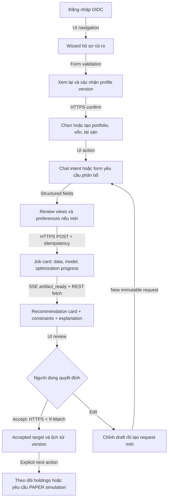

Chat là một cách thao tác, các use case quan trọng vẫn có form. “Tôi muốn tăng tỷ trọng vàng” tạo proposed preference/view để review; không tự sửa target đã chấp nhận. Prompt text không thay cho chữ ký xác nhận profile/accept action. Khi người dùng chỉ hỏi giải thích, không tạo optimization job mới.

### 11.3. Component và trạng thái

- `RiskProfileWizard`, `PortfolioContextSelector`, `ViewEditor` (absolute/relative basket), `JobProgressCard`, `AllocationCard`, `ConstraintReport`, `SourceCitation`, `RebalancePreview`, `DataFreshnessBadge`.
- Các trạng thái loading/queued/running/input_required/partial/degraded/stale/failed/cancelled phải phân biệt; thất bại có mã ngắn và hành động retry/edit phù hợp.
- Card hiển thị VND, %, ngày dữ liệu, ngày tính, model/strategy version, profile version, pending explanation. Không hiển thị “độ chính xác 70%” từ confidence heuristic.
- Accept disable khi expired, superseded, infeasible hoặc thiếu xác nhận. Backend vẫn kiểm tra lại dù nút đã disable.
- Disconnect giữ draft; retry dùng cùng client_message_id/idempotency key. Restore SSE theo sequence và refetch canonical resource; không tạo duplicate card.
- Keyboard navigation, focus rõ, ARIA labels, screen reader summary cho chart, reduced motion. Không encode gain/loss chỉ bằng màu đỏ/xanh.
- Markdown LLM render bằng sanitizer, không raw HTML/scripts; links có nguồn rõ. Không mở arbitrary external URL do tool output tự chỉ dẫn.
- TanStack Query keys chứa user/session scope và portfolio version; clear cache khi logout/user switch. Không SSR/public-cache trang danh mục riêng tư.

### 11.4. Trực quan hóa và metric

| Biểu đồ | Dữ liệu chuẩn và quy tắc |
|---|---|
| Allocation | Donut/stacked bar + bảng weights; so sánh target/current; có cash và nhóm asset |
| NAV / cumulative return | Chuỗi sau phí; legend PAPER/MANUAL/backtest; benchmark cùng khoảng/lịch |
| Drawdown | Từ NAV/time-weighted index thích hợp; ghi rõ max drawdown đã quan sát |
| Rebalance | Before/after weights, drift, trade quantities, phí/spread và residual cash |
| Risk/return comparison | EW/MVO/BL/HYBRID từ cùng experiment protocol; estimated và realized tách riêng |
| Correlation | Matrix của snapshot/window cụ thể, tooltip sample count |
| Forecast/views | Raw prediction, horizon, uncertainty heuristic và applied Q; provenance ML/user/rule |
| Experiment timeline | Train/warmup/validation/test boundaries; không trộn OOS với IS |

API series trả metadata `unit, currency, timezone, calendar_version, adjustment_convention, net_of_costs, provenance`. Downsample server cho khoảng dài nhưng metrics tính trên full-resolution series. Zoom không tự thay cửa sổ thống kê nếu UI chưa chỉ rõ.

MANUAL/PAPER có nạp/rút: báo cáo TWR bằng chia subperiod tại external cash flows với quy ước valuation rõ; MWR/XIRR là metric riêng chỉ khi đủ cashflow. CAGR/Sharpe/drawdown trên normalized wealth index sau flow adjustment, không lấy raw account value có deposit làm lợi nhuận. Backtest NAV không cashflow ngoài phải ghi assumptions, risk-free rate và annualization factor.

## 12. Chatbot, LLM orchestration và RAG

### 12.1. Vai trò và tool contract

Chat Service là state machine tường minh: classify intent → collect missing input → authorized tool call → canonical facts → explain → verify → persist/stream. Baseline dùng provider SDK adapter và Pydantic schemas; chưa cần LangChain/LlamaIndex để điều phối số ít bước. Nếu bổ sung framework, giữ tool schema/state độc lập để tránh khóa workflow vào framework.

Allowlist tools: `get_profile`, `get_portfolio_summary`, `get_market_facts`, `draft_view`, `request_allocation`, `get_recommendation`, `retrieve_knowledge`. Tool arguments validate và portfolio ownership kiểm tra tại owner service. Accept target/record trades/promote model không nằm trong autonomous LLM tools; dùng explicit UI actions.

LLM không được đọc SQL tùy ý, chạy Python, truy cập arbitrary URLs, chọn privileged service identities hoặc nới constraint. Conversation memory gồm summary + relevant messages có token budget; facts hiện hành luôn lấy từ owner API, không tin memory cũ thay profile version.

### 12.2. RAG và grounding

1. Admin nhập tài liệu vetted; Knowledge kiểm tra media/size, malware scan và nguồn URL allowlist; normalize và lưu document version/hash.
2. Chunk theo heading/paragraph, lưu page/section/source/published_at/available_at/access scope. Embedding model/dimension/index version được pin.
3. Retrieval lọc visibility/owner và cutoff **trước khi trả context**; hybrid text/vector rồi rerank optional có latency budget. Corpus backtest chỉ dùng tài liệu đã available tại historical cutoff.
4. LLM nhận passages dưới dạng dữ liệu tham khảo; instructions trong passage không được biến thành quyền gọi tool. Cite source document version + locator.
5. Canonical facts gồm allocation, regime, constraints và diagnostics; LLM chỉ diễn đạt trong evidence budget. Số liệu trọng yếu render trực tiếp từ API card.
6. Dùng structured explanation với fact IDs/reason codes; validator chỉ cho phát câu có số liệu đã match facts. Không dựa regex để chứng minh mọi câu đều đúng; phần không verify được dùng template hoặc báo thiếu bằng chứng.
7. Provider output được buffer theo câu/đoạn trước streaming; status vẫn stream ngay. “First token” nhanh không đồng nghĩa thông tin tài chính đã được kiểm tra.

Tách ba loại nguồn: nội dung tài chính tổng quát từ Knowledge; facts thị trường từ Market; kết quả danh mục từ Portfolio/Quant. Citation văn bản không đủ để xác thực một con số NAV nếu số đó chưa có API fact.

### 12.3. Quản lý chất lượng và chi phí

- Lưu provider/model ID, prompt/schema version, temperature, token counts, latency, tool trace, retrieved chunk IDs, canonical facts hash và verification outcome. Không cần lưu hidden chain-of-thought.
- Eval tiếng Việt gồm câu hỏi đa lượt, ambiguity, relative views, stale facts, prompt injection, missing profile, cross-user IDs, incorrect numeric claims và unavailable providers.
- Đo citation support, numerical fidelity, tool selection correctness, schema validity, refusal-to-act-without-confirmed-input, latency và cost/turn. Dataset phân loại lỗi để chỉnh prompt có version.
- Rate limit theo user, budget tokens/turn và số tools tối đa; đề xuất baseline 6 tool calls, 2 correction attempts, 45 s deadline. Hết budget trả phần đã kiểm chứng và action tiếp theo, không vòng lặp agent vô hạn.
- LLM/embedding providers chỉ nhận tối thiểu dữ liệu cần thiết; không gửi thông tin định danh, credentials hay toàn bộ ledger. Chọn chính sách xử lý/lưu dữ liệu provider trong release gate.


## 13. Triển khai production và vận hành

### 13.1. Topology tham chiếu

```mermaid
flowchart TB
    Internet["Browser / Internet"]
    Edge["DNS + WAF + TLS ingress"]
    subgraph Cluster["EKS: private workloads, 3 availability zones"]
        Web["Web/BFF replicas"]
        APIs["Domain API deployments: min 2 replicas mỗi service public path"]
        Identity["Keycloak replicas"]
        Online["Chat / Quant workers: online node pool"]
        Batch["Ingestion / Training / Research: batch node pool"]
        Control["Outbox, recovery, scheduler leaders"]
        Broker["RabbitMQ: 3 nodes, quorum queues"]
        Telemetry["OTel collectors / metrics / logs"]
    end
    RDS["RDS PostgreSQL Multi-AZ: owned databases"]
    Cache["Managed Redis HA: session và cache tách"]
    Objects["Private S3: versioned artifacts"]
    Secrets["Secrets manager + KMS + workload IAM"]
    External["Market / LLM providers"]
    Registry["Container registry"]
    CICD["CI/CD và Helm rollout"]

    Internet -->|"HTTPS"| Edge
    Edge -->|"HTTPS, fixed routes"| Web
    Web -->|"HTTPS REST / SSE"| APIs
    Web -->|"HTTPS OIDC"| Identity
    Web -->|"TLS session lookup"| Cache
    APIs -->|"SQL TLS, owner credentials"| RDS
    Identity -->|"SQL TLS, identity_db only"| RDS
    Online -->|"SQL TLS, own DB"| RDS
    Batch -->|"SQL TLS, own DB"| RDS
    Control -->|"SQL TLS, own outbox and leases"| RDS
    Control -->|"AMQPS confirms"| Broker
    Broker -->|"AMQPS commands"| Online
    Broker -->|"AMQPS commands"| Batch
    APIs -->|"HTTPS artifact reads"| Objects
    Online -->|"HTTPS verified reads / writes"| Objects
    Batch -->|"HTTPS reads / writes"| Objects
    Online -->|"HTTPS allowlisted egress"| External
    Batch -->|"HTTPS allowlisted egress"| External
    Online -->|"RESP TLS cache"| Cache
    APIs -->|"OTLP gRPC/HTTP"| Telemetry
    Online -->|"OTLP gRPC/HTTP"| Telemetry
    Batch -->|"OTLP gRPC/HTTP"| Telemetry
    Secrets -->|"Scoped secrets / temporary credentials"| Cluster
    CICD -->|"Push image digest"| Registry
    CICD -->|"Kubernetes API: deploy per service"| Cluster
    Cluster -->|"HTTPS pull pinned image"| Registry
```

Các grouped nodes trong deployment diagram là nhiều Deployment độc lập, không gộp service APIs vào một container. RabbitMQ consumers/dispatchers có thể cùng deployment với workers theo owner; scheduler election dùng DB lease, không chạy một scheduler active trong mỗi API replica.

- Namespace dev/staging/prod tách; production credentials/data không dùng trong dev. Production node pools online/batch tách bằng taints, affinity, resource quotas và priority.
- API/BFF ít nhất 2 replicas, topology spread, PodDisruptionBudget. CPU/memory requests/limits explicit; dùng readiness cho traffic, startup probe cho model warmup, liveness không phụ thuộc mọi downstream tránh restart storm.
- HPA dựa CPU/request concurrency; worker scaling theo queue age/backlog và CPU với maximum concurrency budget. Kubernetes hỗ trợ HPA qua resource/custom metrics; cần metrics adapter cho queue signals. [Kubernetes HPA](https://kubernetes.io/docs/concepts/workloads/autoscaling/horizontal-pod-autoscale/).
- Keycloak, broker, DB, Redis cũng phải có capacity/failover tests; tăng API replica không giải quyết bottleneck DB pool hoặc provider quota.
- Graceful drain API/SSE khi rolling update; client reconnect Last-Event-ID. Worker nhận termination thì dừng nhận job, checkpoint/release lease; không ack work chưa commit.
- NetworkPolicies default deny, chỉ mở API/DB/broker/storage/egress cần thiết. TLS nội bộ với certificate rotation; workload identities và service authorization vẫn bắt buộc.
- S3 bucket private, encryption, versioning; prefix/IAM riêng owner, consumers có read scope qua manifest. Versioning giữ nhiều object versions nhưng không tự thay retention policy hoặc quyền xóa. [S3 versioning](https://docs.aws.amazon.com/AmazonS3/latest/userguide/Versioning.html).
- RDS Multi-AZ phục vụ availability/failover; backup/restore và dữ liệu bị xóa nhầm vẫn cần cơ chế riêng. [RDS Multi-AZ](https://docs.aws.amazon.com/AmazonRDS/latest/UserGuide/Concepts.MultiAZ.html).

### 13.2. CI/CD và independent deployment

Mỗi service pipeline: lint/type/schema checks → unit/integration/contract tests → dependency/security scan → image build + SBOM → push digest → migration expand → staging deploy → smoke/E2E → production rollout. Không deploy toàn bộ repository chỉ vì sửa một service.

- Consumer/provider contract tests cho OpenAPI/events và compatibility với ít nhất version hiện hành và rollout kế tiếp.
- Core release chạy numerical golden tests; Quant/Research riêng pin version mới. Model artifact promotion là quy trình riêng với code deploy.
- DB migration chạy một controlled Job với migration credential. Migration destructive cần plan backup/backfill và rollout reader compatibility; rollback app không tự rollback destructive data change.
- Canary dựa lỗi/latency/solver residuals trên deterministic fixture và traffic được phép. Không tự chấp nhận recommendations từ shadow run.
- Promotion model cần data checks, temporal validation, inference compatibility, constraint checks, report và authorized reviewer. Production promotion có audit; research job không có quyền promote.
- Secrets không nằm trong image/.env committed/logs; scan repository và images; rotate qua secret manager.
- IaC và runbooks đặt trong repo. Pin image/library versions khi bootstrap; kiểm tra hỗ trợ/bản vá định kỳ trước nâng.

### 13.3. Observability và SLO

Trace propagation: browser request → BFF → owner HTTP → outbox event → consumer → Quant/LLM → persisted result. Correlation/job/run IDs lưu log; W 3C trace context truyền HTTP headers và envelope AMQP. Không dùng user email/raw prompts làm metrics labels.

| Nhóm | Metric / alert |
|---|---|
| API | p50/p95/p99, 5xx, auth errors, DB pool exhaustion, saturation, error-budget burn |
| Jobs | queue age, time-to-start, completion latency, failed/cancelled, retry/DLQ, expired lease |
| Outbox/inbox | oldest unpublished age, duplicate rate, version gaps, reconciliation failures |
| Market | expected vs arrived data, stale/invalid assets, snapshot lag, revision/quarantine count |
| ML/Quant | model age, coverage, schema failures, inference/selection/solve time, residuals, fallback rate |
| LLM | provider failures/429, grounding failures, template rate, token cost và end-to-end explanation latency |
| Frontend | successful user journey, SSE reconnect/replay gaps, render errors và web vitals |
| Infrastructure | pod restarts, CPU/RAM, DB replica/failover, broker disk/quorum, storage/network errors |

Alerts có owner/runbook, severity và threshold điều chỉnh sau baseline. Initial warning: online job queue age >30 s trong 5 phút, outbox pending >60 s, bất kỳ constraint violation ở recommendation READY, data snapshot trễ hơn source SLA. Constraint violation là blocker ngay; threshold queue không được biến thành lời hứa mọi job <30 s.

### 13.4. Backup, phục hồi và retention

Đề xuất production targets: **RPO ≤15 phút, RTO ≤2 giờ** cho dữ liệu nghiệp vụ trong kịch bản restore được diễn tập; AZ failure cần đánh giá thời gian failover riêng. Cross-region disaster recovery chưa là cam kết bản đầu.

- PostgreSQL PITR + automated backups; weekly restore drill ở staging riêng, monthly exercise toàn workflow. Backup encryption, access audit, retention khởi điểm 35 ngày.
- S3 versioned artifacts, lifecycle theo loại; không xóa artifact còn được run/thesis evidence tham chiếu. Upload checksum, DB manifest và object version được kiểm tra khi restore.
- Broker durable quorum bảo vệ delivery thông thường; không coi broker backup là nguồn duy nhất. Outbox/inbox/terminal jobs phải reconcile sau restore để rebuild work.
- Cross-service restore có thể lệch thời điểm. Trước mở mutation: quiesce consumers, đối chiếu saga/quant/result references, republish missing events idempotently và kiểm tra accepted targets/ledger. Không restore một DB rồi cho client chấp nhận stale recommendation ngay.
- Cache rebuild được; session loss buộc login lại. Runbook phân biệt restore DB, model rollback, provider outage, broker/DLQ và dữ liệu nguồn sửa.
- Retention mặc định đề xuất: SSE events 7 ngày; debug logs 30 ngày; operational/audit events 180 ngày; raw chat 90 ngày; approved thesis evidence giữ đến khi bảo vệ và hoàn tất lưu trữ nghiên cứu. Các mốc cần xác nhận theo chính sách sản phẩm/nghiên cứu trước go-live.
- User deletion đi qua owner services bằng deletion workflow có acknowledgements; revoke sessions ngay, xóa/anonymize personal records và artifacts theo policy. Reference hashes giữ ở mức tối thiểu khi cần integrity. Backup purge theo vòng đời backup và kiểm soát khôi phục để dữ liệu đã yêu cầu xóa không quay lại sản phẩm.
- Không tuyên bố các retention đề xuất là nghĩa vụ pháp lý hoặc chứng nhận tuân thủ.

## 14. Xác thực, phân quyền và bảo vệ dữ liệu

### 14.1. Browser authentication và service identity

1. BFF khởi tạo OIDC Authorization Code + PKCE với state/nonce; callback validate issuer, state, nonce, redirect allowlist và đổi code server-side.
2. Browser chỉ giữ opaque session cookie `HttpOnly; Secure; SameSite=Lax`. Access/refresh tokens lưu encrypted server-side; không localStorage/query string.
3. BFF refresh theo session lock để tránh concurrent refresh race. Logout revoke session và provider tokens theo khả năng IdP.
4. CSRF token + Origin checks cho state-changing cookie requests; same-origin CORS allowlist, không wildcard credentials.
5. Domain service validate JWT signature/JWKS, issuer, audience, expiration và scopes; business ownership kiểm tra trong repository/query.
6. Chat synchronous tools dùng user token đúng audience. Trước enqueue asynchronous intent/tool work, Chat API dùng current user authorization để xin Portfolio cấp delegation grant giới hạn; xem quy tắc dưới. Service-to-service batch dùng workload/client-credentials scopes. Không tự tạo `X-User-ID` header rồi tin như xác thực.
7. Job async chỉ chứa owner reference và authorization decision snapshot từ entry service, không bearer token hết hạn. Execution consumer chỉ nhận trusted producer + command scope; accept vẫn require current active user và current authorization.
8. Admin MFA bắt buộc, session ngắn hơn user, sensitive actions audit. Service accounts không login UI.

OIDC flows/code/client credentials là khả năng nền tảng của Keycloak; token exchange/delegation mapping phải cấu hình và test cụ thể khi bootstrap, không giả định tự có chỉ vì dùng JWT. [Keycloak securing applications](https://www.keycloak.org/securing-apps/oidc-layers).

**Delegation cho chat job bất đồng bộ:** Portfolio cung cấp `POST /internal/v1/delegation-grants` yêu cầu current user token và authenticated Chat client. Grant record gồm subject, actor service, conversation/job correlation, resource scope, tool allowlist, expires_at (đề xuất 5 phút), revoked_at; không chứa quyền accept/trade/admin. Chat local job chỉ giữ opaque grant ID. Khi gọi delayed tool, worker gửi client credentials + grant ID; Portfolio kiểm tra binding, expiry, active user, ownership và tool scope trước xử lý. Grant ID một mình không đủ quyền. Hết hạn cần user resume/re-authorize, không tự gia hạn vô hạn. Không ghi token hoặc grant ID vào event bus/logs; chỉ local DB được bảo vệ. Grant có thể revoke khi logout/account disabled; long-running quant job dùng validated input snapshot, kết quả vẫn cần authorization hiện hành khi đọc/accept.

### 14.2. Role matrix

| Hành động | Investor | Researcher | Data operator | Model reviewer | System admin |
|---|---|---|---|---|---|
| Profile/portfolio/chat | Của mình | Của mình | Của mình | Của mình | Không mặc nhiên đọc mọi dữ liệu riêng |
| Backtest | Presets + quota | Experiment config được duyệt | Không thêm quyền | Read validation reports | Quản quota |
| Ingestion/reconcile | Không | Read datasets | Có | Read datasets | Quản kết nối |
| Train candidate | Không | Có theo quota | Không | Có | Quản tài nguyên |
| Promote/rollback model | Không | Không mặc định | Không | Có | Break-glass có audit |
| Policy/corpus activate | Không | Draft theo scope | Corpus theo scope | Policy theo scope | Cấp role, audit |
| Private record access hỗ trợ | Chủ sở hữu | Không thêm quyền | Không | Không | Just-in-time support scope, có lý do và audit |

Một cá nhân thesis có thể giữ nhiều role, nhưng credentials/scopes và audit actions vẫn tách. Không đưa mọi API vào role “admin” duy nhất để demo rồi xem đó là production authorization.

### 14.3. Các kiểm soát bắt buộc

- Ownership enforcement trên mọi GET/PATCH/accept/download/SSE, cả ID lồng nhau và export artifacts; test cross-user object IDs.
- Request size/date-range/asset-count limits; bounded solver time và native threads; quota ingestion/train/backtest. Cấm remote code/file deserialization không tin cậy.
- TLS, KMS/encryption at rest, least-privilege DB/IAM, secret rotation; logs redact tokens, PII và raw sensitive answers.
- URL ingestion chặn internal/private IPs, redirects ra allowlist và metadata endpoints; file upload kiểm tra content type thực, size và malware.
- Cache key và object authorization không chỉ dựa “UUID khó đoán”; signed downloads cấp sau ownership check, hết hạn ngắn, không public buckets.
- Audit append-only với quyền insert riêng và export tới storage hạn chế sửa; phân biệt audit nghiệp vụ với application log có sampling.
- Dependency/image scan, pinned artifacts, model checksum allowlist. JSON/UBJ không bỏ nhu cầu trusted artifact source và parser patching.
- Client không được tự chọn arbitrary model artifact, solver executable, object key hoặc event routing key.

## 15. Kiểm thử và tiêu chí nghiệm thu

### 15.1. Numerical và data tests

| Nhóm | Bằng chứng cần có |
|---|---|
| Legacy parity | Frozen fixtures cho rule_based, relative, ranking_absolute, EW/MVO/BL/HYBRID; so legacy outputs trong tolerance được ghi |
| Feature parity | Train/serve cùng feature values/order/warmup; history 40/60, missing rows và calendar edge cases |
| Time correctness | Không dùng price/view/document/label available sau cutoff; purge horizon; execution sau decision |
| BL | Matrix shape/order, daily units, prior/no-view semantics, confidence extremes, covariance conditioning |
| Constraints | Property tests budget/caps/floors/turnover trước và sau blending, pruning, rounding; infeasible phải fail rõ |
| Ledger | Buy/sell/cash/fee/corporate actions, reversal, duplicate import, backdated rebuild, TWR với deposits |
| Data | Source units, GOLD paths, revised observations, stale NAV, holiday calendar, point-in-time universe |
| Artifacts | Wrong checksum/schema/version reject; model JSON/scaler round-trip prediction parity |

Tolerances numeric ban đầu: weights ≤1e-6 budget/cap residual, lower bound ≥-1e-8; golden-output tolerances chọn theo solver và fixture, không đồng nhất mọi numerical output với 1e-6. Thay thuật toán được xem là app-v2 behavior, không sửa expected legacy golden để che regression.

### 15.2. Integration, load và failure tests

- Database/API migrations backward compatibility; provider/consumer schemas; service không dùng credentials của DB khác.
- Duplicate message, out-of-order event, event trước HTTP response, worker crash trước/sau commit, publisher confirm timeout, expired lease và stale completion; một canonical result/ledger side effect.
- Accept race giữa hai tab, profile/holdings cập nhật, stale snapshot, revoked view, repeated idempotency key/body mismatch.
- SSE reload/replay/gap/reset, BFF rolling deploy, token expiry, user logout, session cache down; không rò dữ liệu qua event stream.
- Model promotion có serving warmup chậm, rollback event đến trễ, dataset revision giữa forecast và optimize, incompatible feature schema.
- Broker mất một node/AZ, DB failover, S3/provider timeout, Redis cache/session failures; documented degraded behavior.
- Load staging theo mục 1.3 trong 30 phút steady + 15 phút peak, train/backtest chạy song song. Báo cáo p95/p99, job success rate, resource config/cost và ảnh hưởng batch tới online.
- Restore drill từ backup cùng reconciliation cross-service; đo RPO/RTO thực tế. Không chấp nhận chỉ “backup job xanh”.

### 15.3. End-to-end và release gates

1. Bảy UC hoàn thành qua UI với ít nhất hai tài khoản độc lập; test sửa ID để bảo đảm ownership.
2. Mỗi recommendation truy về immutable profile/policy/views/data/model/core version; rerun trong môi trường pin đạt tolerance.
3. Không có READY recommendation vi phạm constraints; lỗi input/dependencies có trạng thái và UI recovery rõ.
4. Chat numeric claims đúng canonical facts trong bộ eval; grounded coverage/latency/cost được báo cáo, không chỉ vài ví dụ đẹp.
5. Đạt load/SLO mục tiêu hoặc điều chỉnh capacity/scope có lý do trước release; training không làm online API vượt error budget.
6. Backup restore, independent service rollout/rollback và model rollback được diễn tập.
7. Provider/source quyền sử dụng, vùng dữ liệu, secrets, retention, quota và ngân sách được xác nhận trong release checklist thực tế.
8. Handover có runbooks, API/schema docs, ADRs, evidence manifest và reproducible experiment commands.

Các gates là yêu cầu phát hành tương lai, không phải yêu cầu người dùng phê duyệt thêm trước khi nhận bản đặc tả này.

## 16. Lộ trình xây dựng từ đầu

Mỗi mốc tạo deliverable chạy/đánh giá được. Thời lượng cần lập sau khi chốt nhân lực và lịch luận văn; không mặc định một người hoàn tất toàn bộ HA/microservices trong vài tuần.

| Mốc | Công việc | Tiêu chí ra khỏi mốc |
|---|---|---|
| M0 — Freeze nghiên cứu và contracts | Snapshot code/data/logs; rà code/report differences; legacy fixtures; ADR boundaries; source/infra budget; OpenAPI/AsyncAPI skeleton | Baseline có manifest, scope/SLO/semantics rõ |
| M1 — Nền tảng production | IaC staging, CI images, Identity/BFF, Portfolio API/DB, per-service auth, outbox/inbox, observability | Login + owner-scoped CRUD + durable job chạy qua broker; rollout/restore tối thiểu |
| M2 — Data và numerical core | Market ingestion/snapshots; extract core; fix time/units/constraints; Quant/ML services, registry, inference/forecast | Portfolio request → Quant → reproducible valid recommendation qua API |
| M3 — Vertical slice người dùng | Risk wizard, portfolio form, chat intent, SSE, deterministic template, charts, accept target | UC1/UC2/UC5 hoạt động end-to-end khi LLM unavailable |
| M4 — Explanation và knowledge | Knowledge ingestion/RAG, grounded LLM explanations, tool audit/evals | UC4, citation/numeric eval có báo cáo |
| M5 — Ledger và nghiên cứu | PAPER/MANUAL, valuations/rebalance, Research backtest/export, admin screens | UC3/UC6/UC7 và shared-core backtest protocol |
| M6 — Hardening và đánh giá | Load/failure/security/restore tests, independent rollout, UX study, cost tuning | Release gates mục 15 đạt; evidence đủ viết luận văn |

Ranh giới dịch vụ được giữ từ đầu, nhưng có thể chỉ bật các service cần cho từng vertical slice. Trước public release phải hoàn thành hardening; không gọi bản demo qua M3 là production hoàn chỉnh.

### 16.1. Backlog ưu tiên có dependency

- P0: time/units/data semantics, user ownership, profile policy compiler, solver feasibility, model manifests, reproducibility, stable API/event contracts.
- P1: personalized request saga, web onboarding/card/forms, SSE, cached forecasts, ledger/rebalance, model management, failure recovery.
- P2: grounded RAG, comprehensive research UI, expanded corpus and asset providers, richer explanation evaluation.
- Hoãn đến khi có nhu cầu đo được: realtime prices, GPU/self-host LLM, Kafka, broker trading, complex autonomous multi-agent framework, additional optimization algorithms.

“P2” là thứ tự xây dựng, không bỏ FR5/FR6 khỏi phạm vi luận văn; các tính năng này vẫn nằm trong tiêu chí cuối cùng.

## 17. Tích hợp kết quả vào luận văn

### 17.1. Bố cục và bằng chứng

| Phần luận văn | Nội dung cần hoàn thiện | Artifacts dùng làm bằng chứng |
|---|---|---|
| Bài toán và tổng quan | Nhà đầu tư cá nhân, BL/views/ML, related work, phạm vi | BC1/BC2, bibliography đã đối chiếu |
| Phương pháp | Data protocol, selection, XGBoost ensemble, confidence, BL/HYBRID, policy | Core formulas, config versions, algorithm pseudocode |
| Phân tích và thiết kế | FR/NFR/UC, architecture/sequence/ERD, ADR trade-offs | Mermaid sources từ đặc tả này, OpenAPI/AsyncAPI |
| Hiện thực | Service boundaries, serving, orchestration, UI, ops | Code versions, deployment manifests, screenshots khi app đã có |
| Thực nghiệm thuật toán | IS/OOS, baselines, ablations, costs, bias và uncertainty | Immutable datasets, experiment manifests, metrics/plots |
| Đánh giá hệ thống | Latency/throughput/recovery, authorization, grounding, UX | Load/failure/E2E reports, eval dataset và study protocol |
| Kết luận | Đóng góp, giới hạn, kết quả chưa đạt, hướng tiếp | Evidence matrix; không biến roadmap thành thành tựu |

Sơ đồ trong đặc tả giữ source Mermaid, không xuất ảnh static trong nhiệm vụ hiện tại. Khi tích hợp LaTeX về sau có thể chọn pipeline chuyển đổi phù hợp theo yêu cầu riêng.

### 17.2. Thiết kế thực nghiệm giai đoạn 2

- Freeze `legacy-v1` để tái lập các bảng giai đoạn 1; đối chiếu log/paper/config khác nhau trước khi khẳng định đã reproduce.
- Freeze development/tuning set và final test protocol. Khoảng OOS đã được xem nhiều lần trong giai đoạn 1 không còn là holdout hoàn toàn mới; báo cáo trung thực việc tái sử dụng và dành future/paper-trading period hoặc nested walk-forward cho đánh giá bổ sung.
- So sánh EW, constrained MVO, BL rule, BL ML, ranking relative/absolute, HYBRID với cùng universe/data/calendar/cost/execution assumptions.
- Ablations: selection vs all assets; ensemble vs single; confidence/volatility scaling; regime layer; personalization; post-blend projection; realistic weight drift/transaction costs.
- Báo cáo gross/net performance, turnover, concentration, MDD, Sharpe/Sortino/Calmar với conventions, missing-data/constituent bias. Không lựa chọn best configuration trên test rồi chỉ công bố kết quả đó.
- Tách **chất lượng danh mục** và **chất lượng giải thích**. LLM giải thích hay không phải bằng chứng cải thiện Sharpe; latency tốt không chứng minh model có alpha.
- Đánh giá UX theo task completion, error rate, time-on-task và questionnaire như SUS nếu phù hợp; người tham gia/consent/thiết kế mẫu ghi trước. Chưa có dữ liệu thì không tự điền điểm hay kết luận hài lòng.
- Lưu reproducibility package gồm experiment config, dataset/model hashes, environment, run commands, tabular metrics và figure-generation scripts.

### 17.3. ADR cần lưu riêng khi triển khai

| ADR | Quyết định |
|---|---|
| ADR-001 | Microservices theo domain; independent DB ownership và deployments |
| ADR-002 | REST + AMQP outbox/inbox + SSE; no distributed transaction |
| ADR-003 | Portfolio-owned durable saga, Quant-owned numerical runs |
| ADR-004 | Precompute forecasts/selection, personalized final optimization |
| ADR-005 | Shared versioned core, legacy-v1/app-v2 semantics |
| ADR-006 | Keycloak/BFF session + per-service authorization |
| ADR-007 | Versioned data/model artifacts và point-in-time protocol |
| ADR-008 | LLM constrained tools/grounded explanation; deterministic fallback |
| ADR-009 | EKS/RDS/S3 reference HA deployment và restore strategy |

### 17.4. Các thông số còn cần xác nhận trước triển khai

Các điểm này không ngăn sử dụng đặc tả để bắt đầu: ngân sách cloud/provider và region; số người dùng thực tế; data licensing/SLA; LLM/embedding model qua eval; numerical profile presets; asset dealing/lot/fee rules; final retention; lịch và nhân lực luận văn. Mỗi quyết định cập nhật ADR/policy version, không sửa ngầm các input của run đã lưu.

---

## Phụ lục A. Những khác biệt cần giữ rõ với giai đoạn 1

| Hạng mục | Code/nghiên cứu hiện tại | Đích giai đoạn 2 |
|---|---|---|
| Giao diện | Python CLI/scripts | Web/chat + REST/SSE |
| Deployment | Research process | Independent services, HA infrastructure |
| Dữ liệu | CSV, split paths, business-day fill | Versioned records/calendars/snapshots và quality gates |
| Model | Train/walk-forward trong research, pickle caches | Offline training/registry + trusted JSON/UBJ serving |
| Configuration | Global constants | Immutable typed per-request policy/config |
| User personalization | Chưa có domain user/profile | Versioned profile/constraints/holdings/views |
| Numerical fallback | Có EW/defensive fallback và post-pruning | Explicit diagnostics; revalidation; no invalid READY output |
| Holdings | Fixed weights dùng lại giữa rebalance trong loop | Quantity ledger, weights drift, explicit execution/fees |
| BL covariance | Posterior mean với historical Sigma | Giữ convention rõ; posterior covariance là extension riêng |
| Logs | Run JSON, chưa đầy đủ artifact hashes | Trace/audit/run manifest + reproducible evidence |
| OOS evidence | Historical logs/paper không đồng nhất config | Frozen protocol và đối chiếu results có version |

## Phụ lục B. Cách đọc và sử dụng tài liệu

1. Dùng mục 1–4 và 16 để chốt phạm vi/mốc triển khai.
2. Dùng mục 5–10 để dựng contracts, schemas, migration và core integration.
3. Dùng mục 11–12 để dựng UI/chat; số liệu luôn đi từ canonical backend.
4. Dùng mục 13–15 làm tiêu chí production và nghiệm thu.
5. Dùng mục 17 cùng PROJECT_CONTEXT để duy trì traceability cho luận văn.

Mọi sơ đồ trong tài liệu là **mã nguồn Mermaid trong fenced code blocks**, có thể copy và chỉnh sửa; không kèm hình static. Đã kiểm tra cấu trúc fenced blocks, JSON examples và references thực thể ERD; chưa chạy Mermaid parser/render engine trong môi trường hiện tại. Các đoạn JSON/Python là contract minh họa, không phải implementation đã được kiểm thử chạy.
