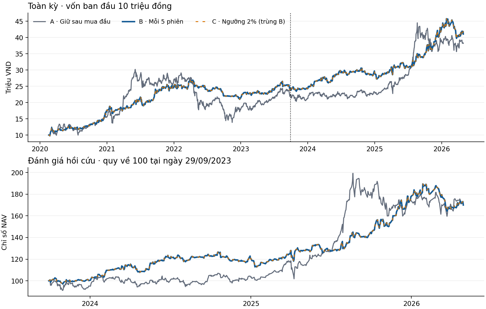

# Ngưỡng lệch tỷ trọng trên dòng mục tiêu HYBRID

Kho lưu mã chứa báo cáo, kết quả tính toán và hash kiểm chứng. Dữ liệu đầu vào đóng băng (`inputs/frames.json.gz`) và hồ sơ nghiệm thu local (`acceptance/`) nằm trong bản lưu nghiên cứu. Cần các tệp đó để chạy lại hoặc mở bằng chứng được dẫn bên dưới.

**Giữ quyết định giao dịch thủ công.** Trong 641 phiên đánh giá hồi cứu từ 02/10/2023 đến 29/04/2026, phương án kiểm tra ngưỡng 2% và phương án tái cân bằng mỗi 5 phiên tạo cùng giao dịch, NAV và chi phí. Cả hai tăng **69,93%** sau phí, có 128 ngày khớp và chịu 3,584 triệu đồng chi phí. Phương án giữ sau mua đầu tăng **70,98%** và có drawdown sâu hơn. Ngưỡng 5% và 10% đều giảm hai ngày khớp nhưng tăng nhẹ tổng chi phí và cho lợi suất thấp hơn. [Bảng kết quả](runs/20261127T145443320859Z/summary.csv) · [Kiểm điều kiện đặt mặc định](runs/20261127T145443320859Z/default-check.json)

## So sánh trên cùng dòng tiền

Mỗi nhánh bắt đầu bằng 10 triệu đồng tiền mặt ngày 18/02/2020. A mua theo mục tiêu đầu rồi giữ. B xem xét giao dịch mỗi 5 phiên. C dùng cùng lịch, ưu tiên thoát cổ phiếu còn giữ với mục tiêu bằng 0 và xét ngưỡng ở các lần còn lại. Tất cả mang nguyên vị thế và tiền chờ qua ngày cắt. Khi tính lợi suất giai đoạn, mẫu số là NAV từng nhánh ở phiên liền trước giai đoạn đó.

| Khoảng đo lợi suất | A giữ | B mỗi 5 phiên | C ngưỡng 2% | B − A (điểm %) | C − B (điểm %) |
|---|---:|---:|---:|---:|---:|
| Toàn kỳ, đến 29/04/2026 | +281,90% | +310,55% | +310,55% | +28,65 | 0,00 |
| Phát triển, đến 29/09/2023 | +123,35% | +141,60% | +141,60% | +18,25 | 0,00 |
| Đánh giá sau 29/09/2023 | +70,98% | +69,93% | +69,93% | −1,06 | 0,00 |
| 02/10/2023–31/12/2024 | +3,45% | +20,46% | +20,46% | +17,01 | 0,00 |
| 02/01/2025–29/04/2026 | +65,28% | +41,06% | +41,06% | −24,22 | 0,00 |

| Trong 641 phiên đánh giá | A | B | C ngưỡng 2% |
|---|---:|---:|---:|
| Drawdown tối đa | −19,90% | −13,21% | −13,21% |
| Turnover lũy kế (lần NAV) | 0,00 | 23,40 | 23,40 |
| Ngày có khớp thực tế | 0 | 128 | 128 |
| Lần gửi giỏ lệnh | 0 | 90 | 90 |
| Chi phí, VND | 0 | 3.584.049 | 3.584.049 |

Trong chi phí của mỗi nhánh B/C, phí cổ phiếu là 1.308.910 đồng và thuế bán cổ phiếu 657.719 đồng. Phí bán VFF là 657.122 đồng và thuế bán VFF 33.446 đồng. Chênh lệch khớp vàng so với trung điểm là 926.853 đồng. Phí mua đầu của A đã trừ trong giai đoạn phát triển. Turnover cộng một nửa giá trị mua và bán đã khớp chia NAV phiên trước. Mỗi ngày có ít nhất một lần khớp chỉ đếm một lần, kể cả ngày VFF khớp sau giỏ cổ phiếu. Drawdown dùng đỉnh lũy kế trong từng khoảng, kể cả NAV đầu khoảng. [Phí theo từng mã và giai đoạn](runs/20261127T145443320859Z/costs_by_asset.csv) · [Dòng giao dịch](runs/20261127T145443320859Z/events.csv)

## Vì sao ba ngưỡng hòa trên tập phát triển?

Quy tắc đã khóa là tối đa hóa lợi suất ròng, sau đó tối thiểu hóa turnover, cuối cùng chọn ngưỡng nhỏ nhất. Ba ngưỡng 2%, 5%, 10% đều cho lợi suất +141,6015% và turnover 36,1204 lần NAV. Lượt tính ghi ngưỡng **2%** vào đĩa trước khi chấm bất kỳ phiên nào sau 29/09/2023. [Protocol](protocol.json) · [Điều kiện drawdown bổ sung trước lượt chạy](default-amendment.md) · [Khóa ngưỡng đầu tiên](inputs/locked-selection.json)

| Quyết định của C ở ngưỡng 2% | Phát triển | Đánh giá |
|---|---:|---:|
| Mở tài khoản và mua đầu | 1 | 0 |
| Cổ phiếu còn giữ có mục tiêu bằng 0 | 125 | 75 |
| Đủ ngưỡng, không có ngoại lệ bắt buộc | 29 | 15 |
| Chờ NAV của lệnh VFF trước đủ điều kiện thông tin | 27 | 38 |
| Độ lệch dưới 2% ở lần đủ điều kiện | 0 | 0 |
| Tổng lịch xem xét | 182 | 128 |

Trên tập phát triển, độ lệch nhỏ nhất ở lần xét ngưỡng thông thường là **10,81%**. Ở các lần bắt buộc, mức nhỏ nhất là **11,37%**. Trong phần đánh giá, các mức tương ứng là **3,96%** và **10,38%**. Vì vậy B và C 2% sẽ cùng giao dịch tại mọi lần đủ điều kiện, ngay cả khi chỉ so độ lệch ở các lần thoát cổ phiếu bắt buộc. Giữ nguyên lịch và điều khoản, C 5% cho lợi suất +69,08% và tổng chi phí 3.584.806 đồng, C 10% cho +69,53% và 3.591.597 đồng. Cả hai có 126 ngày khớp và 89 lần gửi giỏ. Các đối chiếu này dùng để kiểm độ nhạy sau khi đã khóa lựa chọn. [310 lần xét mỗi nhánh](runs/20261127T145443320859Z/reviews.csv) · [Kết quả chọn ngưỡng](runs/20261127T145443320859Z/development.csv)

## Kết quả phụ thuộc điều gì?

| Thay đổi duy nhất, đo trên phần đánh giá | A | B | C 2% | B − A (điểm %) |
|---|---:|---:|---:|---:|
| Chính, vốn 10 triệu VND | +70,98% | +69,93% | +69,93% | −1,06 |
| Phí môi giới cổ phiếu 0 bp mỗi chiều | +70,96% | +76,55% | +76,55% | +5,59 |
| Phí môi giới cổ phiếu 25 bp mỗi chiều | +71,03% | +57,91% | +57,91% | −13,12 |
| Tiền bán VFF về T+1 | +70,98% | +69,93% | +69,93% | −1,06 |
| Cho khớp vàng khi có báo giá trong ngày kể cả giá đứng | +70,98% | +69,36% | +69,36% | −1,63 |
| Vốn 100 triệu VND | +71,21% | +53,06% | +53,06% | −18,15 |

Nếu bỏ cùng năm phiên có trị tuyệt đối chênh lệch lợi suất log ngày B−A lớn nhất, chênh lệch lợi suất lũy kế chuyển từ **−1,06** thành **+8,96 điểm %**. Các ngày gồm 12/01/2026, 25/08/2025, 30/07/2025, 18/04/2025 và 09/04/2025. Phép tính giữ nguyên vị thế và các lần khớp thực nghiệm rồi ghép lãi phần lợi suất còn lại. C−B vẫn bằng 0. Xếp hạng B so với A phụ thuộc chi phí, quy mô vốn, giai đoạn và một số phiên. Đây là đánh giá hồi cứu trên lịch sử dự án đã từng xem. [Chênh lệch ghép cặp và các ngày loại](runs/20261127T145443320859Z/paired.csv)

## Giá, lệnh và khả năng tái lập

Đã đối soát toàn bộ **310/310** mục tiêu HYBRID, từ phiên khớp dự kiến 19/02/2020 đến 28/04/2026, cách nhau đúng năm phiên. Bảng chung có 1.548 phiên từ quyết định đầu tiên đến chốt giá 29/04/2026. Cả 310 ngày có giá đóng cửa cổ phiếu, dữ liệu định giá quỹ, thông tin dùng để quyết định và cặp bid/ask vàng. Trong 310 phiên thực thi đầu tiên của mỗi giỏ, vàng đủ điều kiện khớp ở 247 phiên chính, 308 phiên khi nới cờ đứng giá. Hai phiên chỉ có giá giữ lại không khớp ở cả hai kịch bản. Thiếu thanh khoản vàng chỉ chặn lệnh vàng liên quan. Số phiên có báo giá và số lệnh vàng phát sinh là hai đại lượng khác nhau. [Giao dữ liệu theo ngày](inputs/coverage.csv) · [Hash nguồn, thứ tự tài sản và ảnh chụp](inputs/registration.json)

Cổ phiếu dùng giá đóng cửa điều chỉnh và số lượng chia lẻ. Vàng định giá theo trung điểm, mua theo ask và bán theo bid, cho phép chia lẻ lượng. Mục tiêu HYBRID gốc được giữ ngay cả khi chuỗi SJC sau đối soát khác nguồn vàng đã dùng khi sinh mục tiêu. Giao dịch dùng lượng tiền khả dụng sau khi khóa tiền mua quỹ và giữ tiền bán chờ về. Lệnh VFF dùng NAV thật đúng ngày giao dịch, FIFO và các bậc phí theo tuổi lô. Phiên quyết định dùng vàng đủ điều kiện D+1, VFF đủ điều kiện theo bảng phát hành của Phase 1. Có 65 lần B/C phải chờ xác nhận NAV của giao dịch quỹ trước. Giới hạn lịch sử gồm giá điều chỉnh được lưu hồi cứu, không có sổ lệnh hay lô giao dịch thật và chưa xác minh hết ngày hiệu lực của biểu phí từng đại lý. VFF giữ trong cả ba nhánh. Đối chứng OCB nằm ở nghiên cứu riêng. [Điều khoản và nguồn theo thời kỳ](terms.md) · [Phase 1](../outputs/step1/Step1_Submission_Readiness_20261012/00_Step1_Report.md) · [OCB/VFF](../phase2_ocb_deposits/rebalance_5/REPORT.md)

Lệnh chạy từ thư mục gốc là `venv/bin/python phase2_rebalance/run.py`. Mỗi lần chạy tạo một thư mục riêng, kiểm SHA-256 của ảnh chụp và kiểm kết quả phát triển khớp khóa ngưỡng đầu tiên. Hai lượt với bản sổ cuối cùng cho cùng SHA-256 của tám CSV và bảng kiểm mặc định. Đã đối soát mỗi phiên với lượng tài sản, tiền khả dụng, tiền đã giữ và khoản phải thu. C ngưỡng 0 khớp chính xác B về sổ hằng ngày, giao dịch và số lượng. Lần đầu dừng ở phép kiểm so sánh các cột trống của bảng giao dịch mở. Đã sửa phép kiểm và giữ hồ sơ lượt lỗi. Phiên 26/02/2020 có 1.913.116 đồng chờ về sau bán. Đến 28/02 toàn bộ khoản đó chuyển sang tiền khả dụng. Phiên 25/03/2020 có 3.968.135 đồng giữ mua VFF, 1.534.642 đồng chờ về và 5.720.015 đồng vị thế, tổng NAV 11.222.792 đồng. [Manifest chính](runs/20261127T145443320859Z/manifest.json) · [Đối soát và hash lần lặp](verification.json) · [NAV từng phiên](runs/20261127T145443320859Z/daily.csv) · [Số lượng từng mã](runs/20261127T145443320859Z/units.csv)

Ngày 27/11/2026 đã cập nhật demo local và đối soát luồng người dùng qua trình duyệt, sổ lệnh, biểu đồ lời/lỗ và bảo toàn bản ghi Phase 1. [Biên bản nghiệm thu, phạm vi kiểm tra và số liệu từng phiên](acceptance/20261127/REPORT.md)

Lượt nghiệm thu tiếp theo đã khôi phục bộ đầu vào HYBRID sau điều chỉnh giá FPT. Một tài khoản mới tạo đề xuất, chấp nhận mục tiêu và gửi năm lệnh mô phỏng trên demo local. [Nguyên nhân INPUT_EXPIRED, sổ lệnh và đối soát Phase 1](acceptance/hybrid-fresh/REPORT.md)
